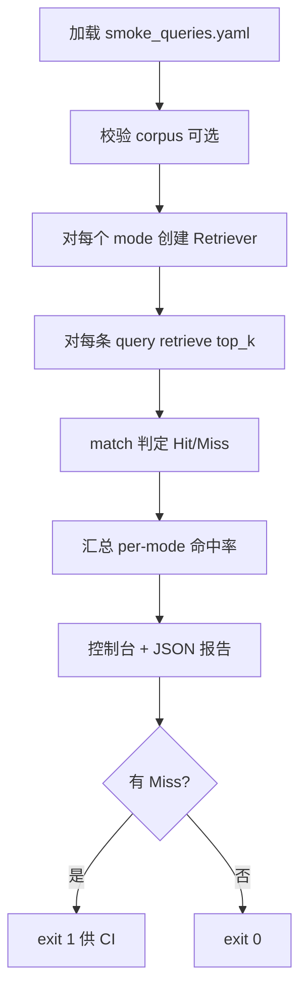

### Smoke 评测要解决什么
Smoke 不是完整 Golden Dataset，而是：

* 条数少（10～20 条），人工能写、能解释 
* 每次改 chunk / 索引 / Retriever 后 1～2 分钟跑完 
* 只评检索：问题 → Top-K 是否出现「该出现的证据」 
* 对比 dense / sparse / hybrid，避免「只测向量」的盲区

通过标准：Hit@K（在 Top-K 里是否命中至少一条 gold），不要求排序第一名一定对。

### 问题模板设计

```yaml
version: 1
dataset_id: claude-code-design-guide-smoke
description: >
  单知识库 Claude Code 设计指南的检索冒烟集。
  改 chunk、建索引或 Retriever 后应跑本集。

# 与索引一致时可写，脚本可做校验（P1 可选）
corpus:
  chunks_path: data/processed/chunks.jsonl
  expected_chunk_count: 444

defaults:
  top_k: 5
  modes: [dense, sparse, hybrid]

queries:
  - id: smoke-001
    question: "MCP 是什么？"
    tags: [concept, english_abbr]
    # 命中规则：满足任意一条即算 Hit（OR）
    match:
      any_section_title:
        - "19.1 MCP 是什么"
        - "19.2 MCP 的架构"
      any_chunk_id_prefix: []   # 可选，如 claude-code-0001-p152
    notes: "缩写 + 概念题，sparse 应不弱"

  - id: smoke-002
    question: "CLAUDE.md 配置文件做什么用？"
    tags: [keyword, exact_name]
    match:
      any_section_title:
        - "2.7 CLAUDE.md 配置"
      any_content_contains:      # 可选，弱约束
        - "CLAUDE.md"
    notes: "专有名詞，测 BM25"

  - id: smoke-003
    question: "query 执行循环是怎么工作的？"
    tags: [semantic, paraphrase]
    match:
      any_section_title:
        - "6.5 query()：真正的执行循环"
    notes: "语义表述，测 dense"

  - id: smoke-004
    question: "Auto-Compact 什么时候触发？"
    tags: [feature_name]
    match:
      any_section_title:
        - "15.2 Auto-Compact 的触发机制"

  - id: smoke-005
    question: "权限有几层？分别是什么？"
    tags: [multi_hop]
    match:
      any_section_title:
        - "22.2 五层权限架构"
    notes: "可能需多 chunk，Hit@5 即可"

  - id: smoke-006
    question: "GlobTool 用来干什么？"
    tags: [tool_name]
    match:
      any_content_contains:
        - "GlobTool"

  - id: smoke-007
    question: "Kafka 消费者如何提交 offset？"
    tags: [negative, out_of_domain]
    expect_hit: false
    notes: "知识库外问题，期望检索不命中（拒答前置）"

  - id: smoke-008
    question: "压缩对话历史的核心思路是什么？"
    tags: [semantic]
    match:
      any_section_title:
        - "15.3 压缩的核心算法"
```

#### 字段说明

|字段|必填| 含义 |
|--|--|--|
| id | ✅ |  稳定 ID，报告和 diff 用  |
|question|✅|用户原问|
|match|命中题 ✅|定规则（见下）|
|expect_hit|否|默认 true；false 表示期望 Top-K 不命中（无答案/越界）|
|tags|否|keyword / semantic / negative / tool_name… 方便分组统计|
|notes|否|给人看，不进逻辑|

#### match 规则（建议 OR 组合，先简单后复杂）
优先级从稳到松：

1. any_chunk_id：最严，适合你已经知道 gold chunk 时 
2. any_section_title：与你们 Phase 1 章节元数据对齐，最适合当前项目 
3. any_content_contains：子串，易误命中，仅作补充 
4. any_chunk_id_prefix：同一文档多 chunk 时放宽

判定逻辑（单题）：

```text
expect_hit == true:
  Hit@K = Top-K 中是否存在任一 record 满足 match 中任意条件
expect_hit == false:
  Pass = Top-K 中没有任何 record 满足 match（或 Top1 score < 阈值）
```

### 脚本逻辑 run_smoke_retrieval.py

#### 职责边界
1. 读 YAML → 调 create_retriever → 逐题 retrieve(k)
2. 算 Hit@K、按 mode 汇总
3. 打印表格 + 写 data/eval/reports/smoke_*.json

#### 流程

#### CLI 建议
```shell
uv run python scripts/run_smoke_retrieval.py \
  --dataset data/eval/smoke_queries.yaml \
  --modes dense,sparse,hybrid \
  --k 5 \
  --report data/eval/reports/smoke_latest.json
```
可选：

* --only smoke-003,smoke-006：调试单题 
* --show-hits：Miss 时打印实际 Top-K 的 section_title / chunk_id 
* --min-top1-score 0.25：hybrid 低分告警（与拒答阈值一致）


### 怎么写这 10～20 条题（可操作步骤）
1. 打开 scripts/review_chunks.py 或自己常问的 10 个问题。 
2. 先搜一遍 search_cli --mode hybrid，记下 Top-1 的 section_title / chunk_id。 
3. 写入 YAML：match.any_section_title 用你看到的章节（可写 1～2 个等价标题）。
4. 题型覆盖（建议比例）：

|类型|条数|测什么|
|--|-|-|
|语义改写|3～4|dense / hybrid|
|专有名詞 CLAUDE.md、GlobTool|2～3|sparse|
|章节编号式 6.5 query|2|sparse + metadata|
|负样本（库外）|1～2|拒答、误召回|
|模糊/稍宽|1～2|hybrid 是否比单路稳|

### 通过 / 失败标准
起步建议（可调）：
* hybrid Hit@5 ≥ 80%（10 条里至少 8 条） 
* negative 题 100% pass（不误命中或 Top1 低于阈值） 
* dense 与 sparse 各自 ≥ 60%（避免一路完全失效） 
* 任一 regression：上次 report JSON 里该题 hit: true 变 false → CI 失败

Smoke 不追求 100%：留 1～2 条「已知难例」标 notes，避免为凑分过拟合。

### 与 Golden 的关系

|类型|Smoke|Golden|
|-|-|-|
|规模|0～20|30～100+|
|标注|section 为主|chunk_id 为主、可多 gold|
|指标|	Hit@5 + 分 tag|Recall@K、MRR、nDCG|
|频率|每次改检索|发版 / 调参前后|

Smoke 的 YAML 可升级：给每题加 gold_chunk_ids: [...]，同一套脚本扩展成 Recall@K，不必重写。
