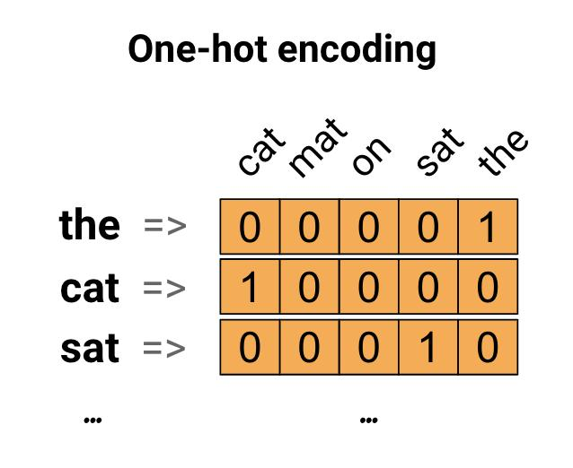
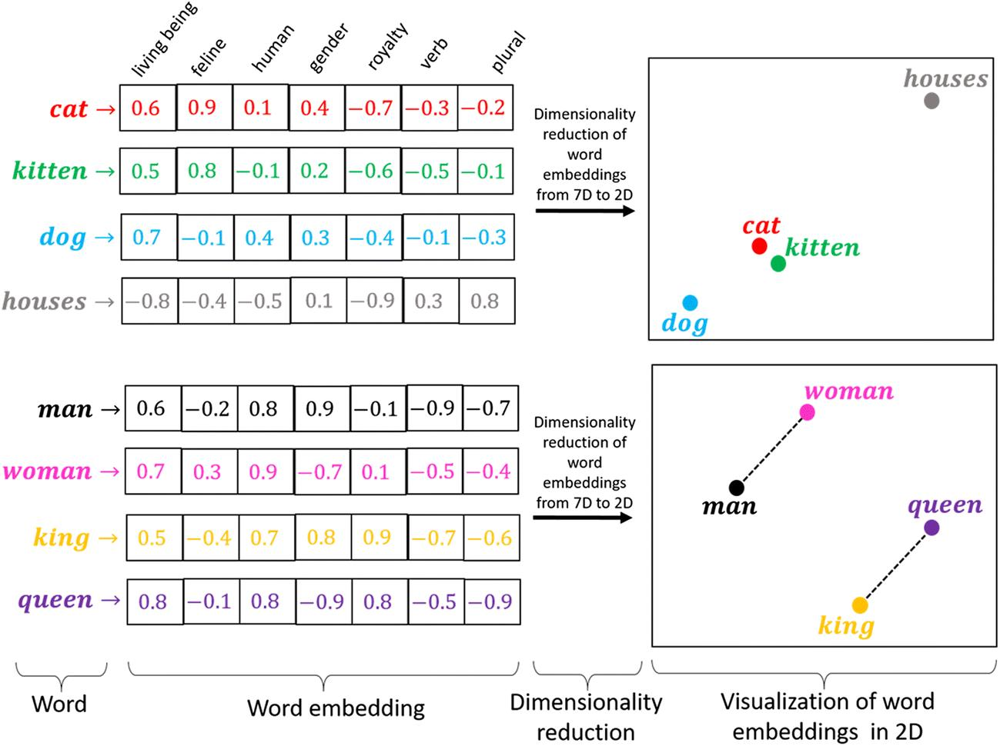
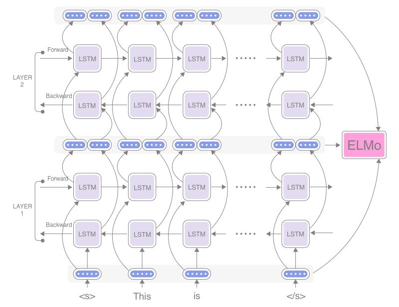
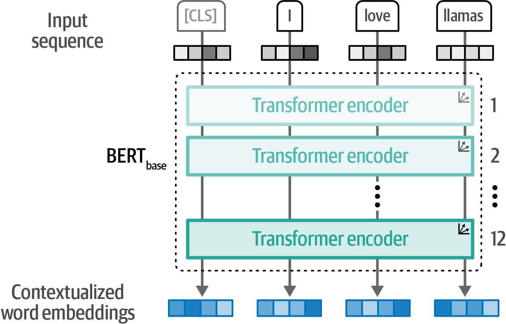
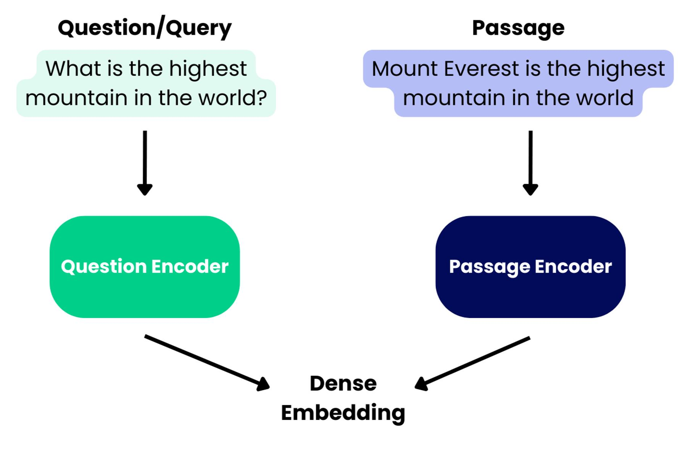
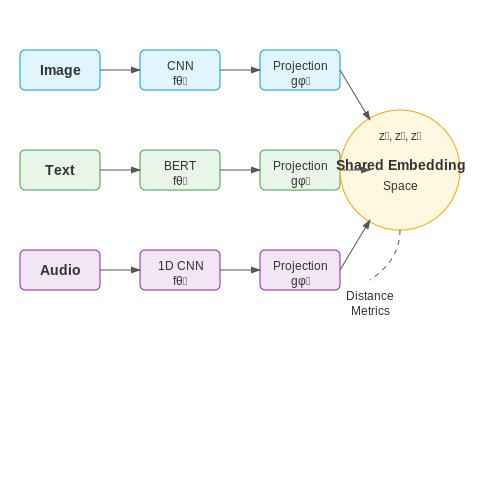

## 向量化
把文本、图片、音频等原始内容转换成向量的过程，通常叫 向量化；在大模型与检索领域里，更常见的名字是 Embedding（嵌入）。

### 向量空间的语义
Embedding 的真正意义在于，它产生的向量不是随机数值的堆砌，而是对数据语义的数学编码。

* 核心原则：在 Embedding 构建的向量空间中，语义上相似的对象，其对应的向量在空间中的距离会更近；而语义上不相关的对象，它们的向量距离会更远。 
* 关键度量：我们通常使用以下数学方法来衡量向量间的“距离”或“相似度”： 
  * 余弦相似度 (Cosine Similarity) ：计算两个向量夹角的余弦值。值越接近 1，代表方向越一致，语义越相似。这是最常用的度量方式。 
  * 点积 (Dot Product) ：计算两个向量的乘积和。在向量归一化后，点积等价于余弦相似度。 
  * 欧氏距离 (Euclidean Distance) ：计算两个向量在空间中的直线距离。距离越小，语义越相似。

### 向量应用方向

#### 判别式模型
核心输入：分类/预测标签
输入：向量 + 分类器
输出：标签
技术特点：监督学习，需要标注数据
场景：情感分析，意图识别，推荐系统

#### 检索式模型
核心输入：查找相似的内容
输入：查询向量+向量数据库
输出：匹配内容（段落，文档，回答）
技术特点：基于相似度
场景：知识问答，RAG 应用，智能客服

## 嵌入技术的发展

### 阶段 1：离散表示与稀疏向量

早期 NLP · 词袋模型、One-hot、TF-IDF
把词表示为离散编号，或高维稀疏向量。实现简单、关键词匹配有效，但难以直接理解同义表达。
例：汽车 和 轿车 通常被当作不同的词项。

### 阶段 2：静态稠密词向量

2013–2014 · Word2Vec、GloVe、fastText
利用词的分布规律学习低维稠密向量。语义或用法相近的词可能在向量空间中更接近。
代表进展：从手工统计词项转向从语料中学习向量。

### 阶段 3：上下文相关的表示

2018 · ELMo、后续 Transformer 预训练模型
同一个词可以因上下文不同而得到不同表示，解决静态词向量难以处理多义词的问题。
例：“苹果发布新手机”与“我吃了一个苹果”。

### 阶段 4：预训练语言模型表示

Transformer 能利用双向上下文学习表示。Sentence-BERT 等方法进一步针对句子级语义相似度和向量检索进行训练。
重要转变：不再只表示单个词，而是学习整个句子或文本片段的表示。

### 阶段 5：面向检索的 Embedding

2019–2022 · DPR、对比学习、E5、BGE 等路线
通过查询—文档配对、正负样本和对比学习，让相关查询与目标文本在向量空间中更容易匹配。
重要转变：从“文本表示得好不好”走向“能不能把正确的文档检索出来”。

### 阶段 6：指令化、多语言与多模态 Embedding

2022–至今 · 任务适配、跨语言、文本图像联合表示
模型能够更好地适配检索任务、不同语言和不同内容类型。部分模型把文本与图像映射到可比较的共享空间，也有模型支持更广泛的多模态输入。
重要转变：从通用语义向量发展为适应具体任务的表示系统。

