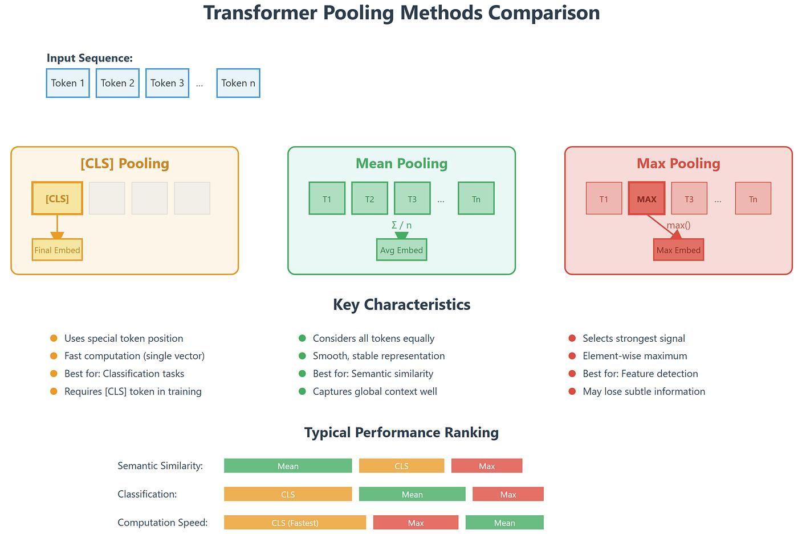
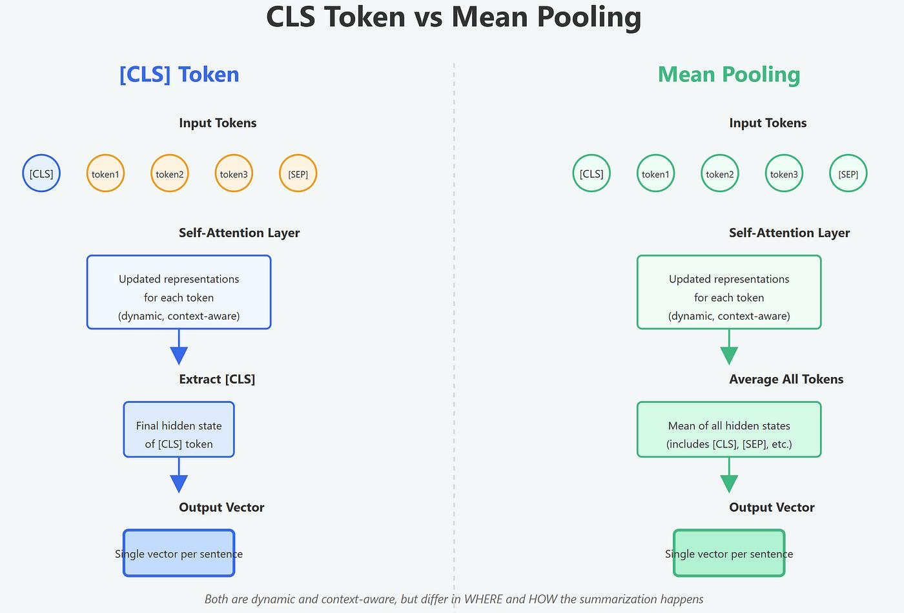
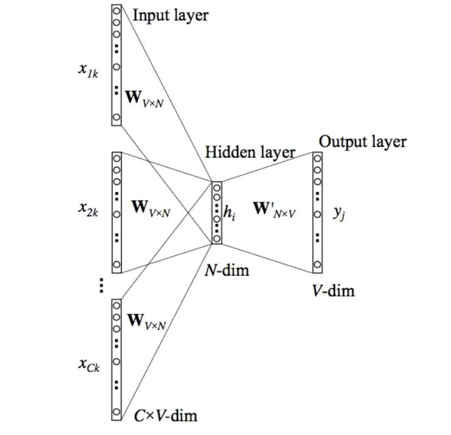

## 为什么要分块
将文本分解成适当大小的片段，一便于嵌入，索引和存储，并提高检索的精确度。还有一个就是模型上下文的局限。

### 分块大小对检索精度的影响
Chunk Size 不会直接改变 Embedding 模型本身的能力，但会改变模型看到的文本内容，进而影响向量的语义表达、检索结果的粒度，以及最终答案的质量。

Chunk Size 影响索引精度的核心机制可以概括为：

* 太小： 检索粒度细，但可能丢失上下文，相关知识容易分散。

* 太大： 上下文较完整，但主题可能混杂，检索结果可能带来更多无关信息。

* 合适： 一个 Chunk 尽量对应一个相对完整、可独立理解的知识单元

一个好的文本块应该聚焦于一个明确、单一的主题。如果一个块包含太多不相关的主题，它的语义就会被稀释，导致在检索时无法被精确匹配。

### 从 Embedding 原理理解：为什么大块可能降低检索精度？

#### 理解嵌入的过程
在本文嵌入生成时，经过 Transformer 的处理，输入的数据就会被压缩成一个固定维度的向量（如：768 维的向量）假设模型输出 768 维向量，
那么无论 Chunk 有 100 个 Token 还是 800 个 Token，最终都可能得到一个 768 维向量。。

我们可以理解成：Transformer 并不是直接把一段文本压缩成一个向量，而是先为每个 Token 生成一个上下文相关的向量，
再通过 Pooling 等方式，将多个 Token 向量汇总成一个固定维度的文本向量。

假设 RAG 系统中有一个 Chunk，我们希望将它转换成一个 768 维向量，供后续的向量检索使用。大致经过如下的步骤：
1. 原始文本经过 Tokenizer：文本切分为 Token。
2. Embedding Layer + Transformer Encoder 将第一步中得到的 token 通过 768 维的上下文表示
3. Pooling：聚合 Token 向量，一个 Chunk → 一个向量

注意：768 维只是示例。实际维度取决于你选用的 Embedding 模型；有些模型直接输出句子向量，或者采用其他汇聚方式。


#### tokenID 是如何变成向量的
假设词表中有 50,000 个 Token，模型的隐藏维度是 768，那么模型可以维护一个可学习的 Embedding 矩阵：

                E∈R^50000×768

可以把它理解为一本很大的“向量字典”。

* 每一行对应一个 Token ID。 
* 每一行有 768 个数值。 
* 输入一个 Token ID，就可以查出对应的 768 维向量。

对于一段有 n 个 Token 的文本，查表后会得到一个矩阵：

                X∈R^n×768


#### 将 Token 级向量转换成 Chunk 级向量
**为什么不直接把最后一层的全部输出存入向量数据库？**

因为标准的文本向量检索通常需要一个固定维度的向量代表整个 Chunk。若每个 Chunk 都存储全部 Token 向量，存储成本和检索计算方式都会不同。
所以，常见的下一步是将 Token 级表示汇聚成文本级表示。


##### Mean Pooling（平均池化）
对每个向量维度，计算所有有效 Token 的平均值，得到一个固定维度的向量


##### CLS / 特殊 Token 池化
取模型指定位置的隐藏状态作为文本表示。有些模型会围绕这个位置进行专门训练，不能假设任意 Transformer 的第一个 Token 都适合直接用于检索。


##### 投影层或模型专用输出头
一些模型会对汇聚结果做线性变换或其他专门处理。例如，将 1024 维的内部表示映射为 768 维输出。


还有一个重要区别：有些 Embedding 模型采用基于 decoder 的架构，并通过最后一个有效 Token、特定隐藏状态或专门的输出头生成文本向量。它们不一定采用 Mean Pooling。

因此，不能认为所有 Embedding 模型都是“Transformer + Mean Pooling”。最终向量的生成方式由具体模型的架构、训练目标和实现决定。


#### 总结
在这个压缩过程中，信息损失是不可避免的。一个768维的向量需要概括整个文本块的所有信息。文本块越长，包含的语义点越多，
这个单一向量所承载的信息就越稀释，导致其表示变得笼统，关键细节被模糊化，从而降低了检索的精度。


### 从生成过程理解为什么快不是越大越好

#### 生成过程的“大海捞针” (Lost in the Middle)
即使将检索到的多个大块文本都塞进LLM的长上下文窗口中，也会出现关键信息被“淹没”在大量无关内容里的问题。当LLM处理非常长的、充满大量信息的上下文时，
它倾向于更好地记住开头和结尾的信息，而忽略中间部分的内容。

如果提供给LLM的上下文块又大又杂，充满了与问题无关的噪音，模型就很难从中提取出最关键的信息来形成答案，从而导致回答质量下降或产生幻觉。

#### 分块大小对生成质量的影响
分块大小（Chunk Size）会影响生成质量，因为它决定了检索系统能够向 LLM 提供什么样的上下文信息。

* Chunk 太小：信息容易被切碎，检索到了关键术语，却缺少解释它所需的上下文。

* Chunk 太大：无关信息容易混入，Embedding 的语义焦点可能变模糊，有限的上下文窗口也更容易被占用。

* Chunk 合适：每个块尽量包含完整、相关、可独立理解的信息，使检索结果既准确又足够回答问题。

## 实现带长度限制和重叠的文本分块器
按字符长度切分长文本。

设置 Chunk 的重叠长度（overlap）。

让 Chunk 保留页码和文档元数据。

理解为什么字符长度不等于 token 长度。

通过测试验证 Chunk 的切分结果。

## 实现基于段落的语义分块

按照字符位置切分存在几个问题：

```text
1. 可能把一个段落从中间切开。
2. 可能把一句话或一个代码示例拆成两半。
3. 不能很好地保留文档原有的结构。
4. 即使设置了 overlap，也不一定能保证上下文完整。
```

优先按照空行拆分段落。

1. 尽可能把多个短段落合并到一个 Chunk。 
2. 超长段落再使用字符切分。 
3. 保留现有的 DocumentChunk 数据结构。 
4. 添加边界测试。 
5. 将新的分块器接入 PDF 构建流程。


### Chunking 不是简单的字符串截断
Chunking 是在几个目标之间做平衡：
```text
Chunk 太小
  ├── 上下文不足
  ├── 检索结果碎片化
  └── 需要召回更多 Chunk

Chunk 太大
  ├── 检索精度可能下降
  ├── 相关信息被无关内容稀释
  └── LLM 上下文成本增加
```
因此，chunk_size=500 和 overlap=50 不是通用的最佳参数，而是需要通过评估数据验证的实验参数。

### 文档结构比盲目 overlap 更重要
对于技术文档，以下信息通常具有较高价值：

* 标题和章节。 
* 完整的定义。 
* API 参数说明。 
* 配置示例。 
* 代码片段。 
* 前置条件和限制条件。

如果为了添加 overlap 而把段落从中间切开，可能反而损害文档结构。

### Chunk 的质量最终由检索评估决定

当前我们可以做结构性检查，但还不能断言 Chunking 已经适合问答。
后续需要通过 Golden Dataset 测试：
```text
用户问题
   │
   ▼
检索 Top-K
   │
   ▼
相关 Chunk 是否被召回？
   │
   ▼
Recall@K
```

如果相关 Chunk 总是没有被召回，那么即使 LLM 本身能力很强，最终回答也可能不正确。


## 实现跨页 Chunking

按照段落分块导致一个逻辑问题：

```text
PDF 的页面边界不一定是语义边界。一个完整的段落、代码说明或章节内容可能跨越多个页面。
```
因此我们把流程调整为：
```text
PDF 页面
   │
   ▼
提取所有页面文本，并保留页码
   │
   ▼
按页面顺序合并成段落单元
   │
   ▼
段落优先分块
   │
   ▼
为每个 Chunk 计算实际的起止页码
   │
   ▼
DocumentChunk
```


## 识别文档章节和标题
我们已经完成了：

```text
PDF 文本提取。
段落优先分块。
跨页 Chunk。
page_start 和 page_end 来源信息。
```
章节识别已经接入 `build_chunks`：标题不会写入正文，段落可跨页，同章节短段落可合并，跨章节不会合并。

早期每个 Chunk 曾经是：
```python
section_title="Unknown"
section_path=[]
```
这会影响后续检索和引用。如果我们只保存正文，而不保存章节上下文，就很难区分它们在文档中的位置。规则驱动的章节识别器流程：
```text
原始文本
   │
   ▼
识别可能的标题
   │
   ▼
维护当前章节路径
   │
   ▼
将章节元数据附加到段落
   │
   ▼
构建带章节信息的 Chunk
```

## Unstructured 工具给 pdf 文档分块
