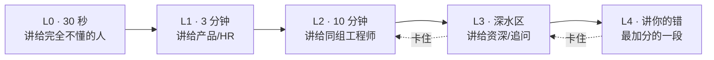
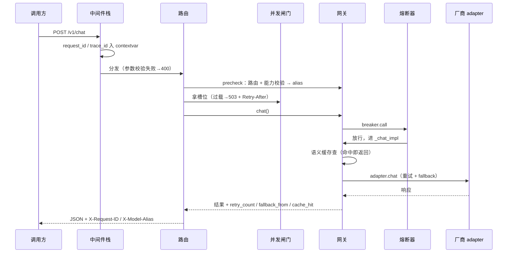
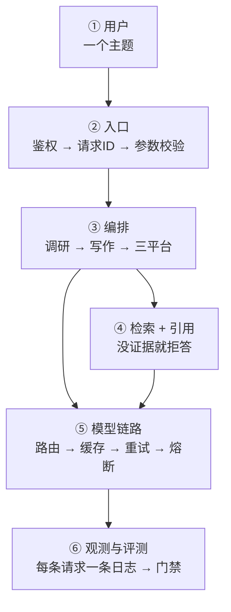

# 面试准备：用费曼法把这个项目讲明白

> 用法先说清：**这份文档不是拿来读的，是拿来讲的。**
> 每一层都是一段「闭卷讲 N 分钟」的脚本 + 自检题；讲不顺才回去看对应的文件——
> 卡住的地方，就是你其实没懂的地方。
>
> 已有 `docs/w12/interview-prep.md` 是按 JD 十条职责逐条挂数字（对号入座用）。
> 本文是它的反面：**先把事情讲懂，再谈对号**；并且把那份文档里几个经不起追问的数字挑了出来。

---

## 0. 先立规矩：费曼四步怎么落到这个项目上

| 步骤 | 在项目里的具体动作 | 卡住时去哪 |
|---|---|---|
| ① 选一个概念 | 一次面试只会给你 3–15 分钟讲一个点，先选：**「它怎么工作」**而不是「我做了哪些模块」 | — |
| ② 讲给外行 | 禁用术语讲 30 秒（L0），外行能接话 | 讲不出，说明你只知道名词不知道因果 |
| ③ 卡住就回原文 | 每层都标了「卡住信号 → 回哪看」 | 对应周文档 / 代码 |
| ④ 简化 + 类比 | 每个深水区问题都要有一个 1 句类比 | 没有类比 = 还在背 |

**这个项目最容易被讲糊的三个地方**（先记住，后面每层都会回来）：

1. **熔断不是重试**——它是一个「决定不再尝试」的开关，加进去以后上游调用数必须**恰好不变**。
2. **公共 API 是扫出来的，不是想出来的**——13 个顶层符号由产品真实 import 反过来定。
3. **多 Agent 在这批任务上没有分工收益**——差异全部由「上下文窗口」解释，不是范式。



---

## 1. L0 · 30 秒：讲给完全不懂的人

### 脚本（可逐句背）

> "这是一个帮市场团队干活的 AI 系统。
> 你给它一个主题，它先去查资料，再按品牌规矩写成文章，最后改成三个平台各自的版本；
> **每一句事实都要标出处，没找到出处就不写**，而不是凭印象编。
> 我做的事情不是'让它能跑一次'，而是'敢给别人用'：
> 出错能查到卡在哪一步、上游挂了不会整个崩、钱花在哪儿能看见、别人装个包就能接着用。"

### 这一层禁止出现的词

RAG、Agent、embedding、熔断、评测集、token、p95。
理由：这些词一出现，对方就会以为你已经在解释，其实你把「没想清楚」藏起来了。

### 费曼自检（闭卷，出声讲）

1. 它能干什么？（一句话：查资料 → 写文章 → 改三平台 → 每句带出处）
2. 它凭什么不胡说？（没有证据就拒答，不是"降低置信度"）
3. 你做了什么？（把它从"能跑"做到"能一直跑"）

**卡住信号**：如果你不自觉开始说"我们有一个 retrieval pipeline……"——
说明你在用模块名代替因果。回 `README.md` 的「一句话」那三行重讲。

---

## 2. L1 · 3 分钟：讲给产品 / HR / 面试开场

### 一条主线（先讲这条，别讲模块）


### 四个「它能」+ 四个「它不能」

| 它能 | 它不能 |
|---|---|
| 把一句话主题扩成可发布的文章 | 保证文章"打动人心"——质量没有自动化判据 |
| 每句事实挂引用编号，悬空编号直接判错 | 处理没有资料支撑的选题（会拒答，不硬编） |
| 记住你上次说的偏好（"别说行业领先"） | 跨用户共享记忆（记忆按用户/团队 namespace 隔离） |
| 把上游故障变成可读的错误码 | 在上游全挂时"换个模型救回来"——那等于第二次重试，明确放弃 |

**为什么先讲"不能"**：面试官判断你懂不懂，看的是你知不知道边界。
讲完边界再讲能力，后面的数字才有人信。

### 可演示的三条命令

```bash
uv run agent-server                                   # 起框架服务
curl -s -X POST localhost:8000/v1/chat -H 'content-type: application/json' \
  -d '{"messages":[{"role":"user","content":"你好"}],"task":"chat"}'
uv run python evals/scripts/w12/api_audit.py --check       # 公共面审计：0 泄漏 / 0 空壳
```

### 费曼自检

1. 用「输入 → 四步 → 输出」讲完主线，不许出现"模块"两个字。
2. 说出两个"它刻意不做"的事，以及为什么。
3. 对方问"这跟直接把 prompt 拼起来有什么区别"——你怎么答？
   要点：区别在**出处的可验证性、失败的可见性、成本的可见性**，不在"多调了几次模型"。

**卡住信号**：讲完对方问"所以它是聊天机器人吗？"——说明你的主线讲成了对话，不是流水线。
回 `apps/growth_agent/src/growth_agent/routes_article.py` 看四个 stage 的输入输出。

---

## 3. L2 · 10 分钟：讲给同组工程师

这一层要能被追问"那具体怎么做的"，所以必须能手画。

### 3.1 一次 `/v1/chat` 的生命周期（8 步）



要能讲出的三个"为什么"：

- **`precheck` 为什么必须在返回流之前**：流式是先发 200 header 再吐 body，进了生成器，任何错误都只能变成"200 但内容是错误帧"。
- **槽位为什么在 gateway 之前拿**：在 gateway 里拿不到槽位会被当成上游错误去重试，"入口过载"就变成"多倍流量"。
- **为什么每条响应都带 `retry_count` / `fallback_from`**：不是给人看的，是给成本与归因用的——"这次贵是因为换了模型"，必须能算出来。

### 3.2 服务里那五件东西，和"为什么都能注入"

`create_app()` 装配五件：`gateway` / `exporter` / `session_store` / `limiter` / `task_queue`，全挂在 `app.state`，全部可传参覆盖。

一句话讲清价值：**测试用内存实现、生产用 Redis 和真厂商，走的是同一行装配代码**——
"测试走一条路、生产走另一条"是这类项目最常见的假绿来源。

### 3.3 错误码只有一处投影

`llm/errors.py` 里的 `error_code_for()` / `http_status_for()` 是唯一真相；
`server/errors.py` 只做"异常 → 响应体"的翻译，**不重新定义状态码**。

为什么值得讲：产品应用（`apps/growth_agent`）复用同一个 `install_error_handlers`，
所以同一个上游故障在框架和产品两侧不会返回两个不同的 code。
顺带一个反直觉细节：参数校验失败返回 **400**，不是 FastAPI 默认的 422——
因为对外只该有一个"你参数写错了"的档位。

### 3.4 长任务为什么必须走队列

`POST /v1/tasks` 只做三件事：校验 → 入队 → 立刻 202。
消费者是 `asyncio.Task`，不是线程；它不在任何 HTTP 上下文里，所以**必须显式恢复 `request_scope` / `trace_scope`**，否则任务内部的模型调用会产出空 trace_id，链路从这里断掉。

另一个必须讲的细节：入队时**先登记记录再投递**。反过来写，跑得快的消费者会查不到 id，
任务被静默丢弃，而记录永远停在 `queued`——这种 bug 只在并发时出现。

### 3.5 配置的唯一真相

`models.yaml` 定义模型价格/能力/路由/限额，`Settings` 只放运行参数，组装只发生在 `bootstrap.py`。
一句话：**同一个东西的定义只能有一处**，否则"改了配置没生效"会变成常态。

顺带一个"能救场"的事实：检索默认是**单路 dense**（`retrieval_mode="dense"`），
重排和改写默认都是关的——不是没做，是实测不划算（见 L3-7）。

### 3.6 测试是分层的，不是一堆

| 层 | 例子 | 证明什么 |
|---|---|---|
| 契约/单元 | `test_circuit_breaker.py`（22 条） | 逻辑对不对 |
| 端点级 | `test_article_route.py`（12 条） | 接线对不对（用脚本化网关，不调真模型） |
| 离线评测 | `evals/golden/*.jsonl` + 门禁 | 有没有变差 |
| 真机（live） | 30 条默认 skip | 协议对不对（需要 key） |

**必须主动说**：1471 条里 30 条是 skip 的 live 用例，"全绿"不等于"跑过真实模型"。
主动承认这条，比被问出来强得多。

### 费曼自检

1. 白纸上画出上面那张时序图，标出"哪里可能返 400 / 503 / 500"。
2. 解释"为什么队列消费者要手动恢复 contextvar"。
3. 被问"你的测试能证明什么、不能证明什么"，用 30 秒答完（提示：能证明接线与逻辑，不能证明生成质量与真实延迟）。

**卡住信号**：如果你把 `precheck` 和 `chat` 说成一回事——回
`docs/server-question-answers.md` 第 3 问（LLMGateway 的六个入口）。

---

## 4. L3 · 深水区：8 个必答题

每个问题三段式：**30 秒答案 → 支撑数字 → 追问怎么接**。

### 4.1 为什么自研框架，不用 LangGraph？

> 因为我要的守卫（**步数 / 预算累计 / 环路**）必须放在"能看见全局"的位置，
> 而 LangGraph 里它们只能寄生在某个节点内部，靠"这个节点一定会跑到"来保证生效。
> 这不是调参问题，是编排范式里没有那个位置。

- 数字：LangGraph 版作为**可选 extra 真跑过对照**（不装就跑不出来，等于没做对照）；
  实测它的中止原因里多出一个 `recursion_limit`，不在我们的枚举里（`docs/w9/adr-w9-langgraph-dependency.md`）。
- 追问"那你抄它的调度不就行了"→ 答：调度最容易抄，**守卫的位置抄不来**；
  而且我真正需要的只有两种编排（Plan-and-Execute 与 Workflow），多引 18 个包换不来。

### 4.2 为什么"重试只能有一个主人"？

> 因为重试是最容易被叠三层的东西：适配层重试、网关重试、调用点再重试。
> 三层各 3 次，一次故障就是 27 倍流量，日志里看起来只是"重试有点多"。

- 数字：混沌演练 F1（超时）：阈值 3、`max_attempts=2`、候选链 3 条 → 每次 `chat()` 打 6 次上游；
  放行 3 次正好 18 次，之后 9 次请求**一次都没打上游**（`docs/w11/chaos-report.md`）。
- 追问"那熔断器自己失败后不重试吗"→ 不。它的贡献必须**恰好为 0**，
  上游调用数只由「放行次数 × 候选链 × max_attempts」决定，这个乘积归网关。

### 4.3 熔断为什么在网关里，限流为什么不在？

> 一句话：**限流是"入口收不收这个请求"，熔断是"上游还能不能打"。**
> 前者放进来会把过载变成重试；后者放在 4 个调用点上，新增一个调用点就漏一个。

- 追问"熔断打开时用户看到什么"→ 503 `CIRCUIT_OPEN`，不排队、不重试、不换模型。
- 再追问"半开怎么保证不打垮刚恢复的上游"→ HALF_OPEN **只放行一个探测**，
  用布尔而不是计数（计数在异常路径漏减一次就永久卡住）。

### 4.4 语义缓存凭什么敢开？错了怎么办？

> 三道闸：相似度阈值 0.92、TTL、**资产版本**。
> prompt 或模型换了，旧答案就不是"这套系统会给出的答案"，命中即作废并单独计数。

- 数字：W11 成本 A/B 缓存 **−37.6%**（16→10 次调用）。
- 最难的一条（必须讲）：第一版缓存**从未命中**——`_cacheable` 里写了"带采样参数就不缓存"，
  而产品端每个请求都带 `temperature`。单测全绿，因为单测的调用不带 opts。
  修法：opts **进缓存键**而不是排除（不同温度是不同问题）。
- 追问"时效性问题呢"→ 含"今天/最新"这类词的查询直接不进缓存，`blocked` 单独计数。

### 4.5 记忆和知识库怎么划界？

> 判据只有一条：**和用户绑定还是和文档绑定**。
> "不要说行业领先"属于用户；"返点政策第 3 条"属于文档。

- 落地：同库、**不同表**（`agent_memories` vs `rag_chunks`，按用户/团队 namespace 隔离），放弃的是独立库那种物理隔离；召回按当前问题，
  与检索**各占预算槽位**，不互相抢。
- 数字：W7 20 轮对话，滚动摘要把末轮输入 2758 → 1630 token，
  净成本 0.0661 → 0.0563 元（**−14.8%**，已扣掉摘要本身的成本）。
- 追问"压缩会不会丢关键信息"→ 会，所以压缩只动"上下文视图"，原文仍在会话存储里；
  这决定了"摘要坏了还能回退"。

### 4.6 评测怎么防止"看起来很好"？

> 三层防线：golden 集只做**回归**不做及格线；judge 只在**一致性可证明**时才采信；
> 门禁判"有没有变差"而不是"分数够不够高"。

- 数字：`HeuristicJudge`（纯规则）的二次加权 kappa **0.343** / 名义 **0.200**，
  这个数被当成**下限**——任何 LLM judge 必须显著超过它才准用；门禁看更严的名义 kappa。
- 追问"kappa 低为什么还留着规则 judge"→ 它是**兜底与基线**：judge 不可用时门禁不能空转。
- 再追问一个真实缺口（加分）：上线路径的九态执行模型有映射表、有演练，但**没有替换掉队列里那套四态记录**（`docs/w11/reliability-report.md` §0）。

### 4.7 RAG 最后为什么是"单路 dense"？

> 因为每一层增强都被实测否掉了——这是最反直觉、也最能证明"我在做实验而不是堆功能"的一段。

| 配置 | Recall@5 | 检索 p95 | 结论 |
|---|---|---|---|
| **dense（采纳）** | **.9643** | 160ms | 默认 |
| hybrid（dense+sparse+RRF） | .8571 | 159ms | **比单路都差**（分词器有缺陷） |
| dense+rerank | .9286 | **5.4s** | 质量、延迟双输 |
| dense+rewrite | .8929 / .9643 | **15.2s** | 两次跑都不如不改，还花钱 |

（`docs/w5/rag-ab-report.md`，28 条正例；样本小，必须自己说"样本小"。）

- 追问"那你还写 RRF 干什么"→ 保留为实现与对照；融合不是错，**在这批语料上不划算**。
- 追问"重排为什么这么慢"→ 本地 CPU 跑 bge，20 候选；生产上若要开必须先有 GPU 预算。

### 4.8 公共 API 是怎么定的？

> 不是"我觉得该暴露什么"，是**扫产品真实 import 反推**：
> `evals/scripts/w12/api_audit.py` 用 AST 扫五个使用域，产品在用的 54 个模块 / 208 个符号才算契约。

- 数字：顶层只留 **13 个**符号（起一个服务 + 发一条 chat 所需），
  门禁是 0 私有符号泄漏 / 0 空壳模块 / 0 子包缺口。
- 最难的一条：脚本第一版用运行时 `__module__` 猜符号归属，
  遇到 `router = APIRouter()` 这种对象就判错（它报的是 `fastapi.routing`），整个公开符号集算错——改用 `ast.parse` 才对。
- 追问"产品用了一个私有函数怎么办"→ 正确做法不是导出私有符号，而是**导出那个判断**
  （`is_explicit_memory()`），把"正则"换成"语义"。

---

## 5. L4 · 讲你的错（面试最加分的一段）

规律：**面试官记不住你做了 12 周，但会记住你讲清了一个 bug。**
每段控制在 90 秒，结构固定：

> 现象 → 我当时的错误假设 → 哪个证据打翻了它 → 改法 → 代价

### 5.1 三个"测试全绿但机制不存在"（W11 D5 一次抓出三个）

| 机制 | 我的错误假设 | 打翻它的证据 |
|---|---|---|
| 语义缓存 | "单测过了，缓存就在工作" | 真实路径每个请求都带 `temperature`，全被判 miss |
| Skill 漂移检查 | "键变了就报异常" | 正确做法（改内容也改版本）同样被报，清单没人看 = 没有 |
| 缓存统计 | "过期就记 miss" | 同一查询既记 `expired` 又记 `miss`，命中率分母翻倍 |

共同形状：**判断写在一处、断言写在另一处，两处对"什么算命中"理解不同。**
这句话可以直接当"你从中学到什么"的答案。

### 5.2 一个真事故：隔离封皮流进了文章标题（INC-2）

> 我们给用户输入包一层"不可信封皮"（`<untrusted source="user">…</untrusted>`），
> 检测时要把内层文本剥出来。结果**剥出来的文本被当成正文继续往下传**，
> 最终出现在标题里——200、无告警、红队全绿、误报率 0%。

- 根因一句话：**检测用的投影被当成了数据本身**。
  `unwrap()` 返回 `(inner, source)`，调用方只关心"能检测就行"，顺手把 `inner` 用了下去。
- 为什么最难发现：两段字符串**类型都是 `str`**，不报错；
  而且红队只看"拦没拦住"，误报率只看"正常输入放没放行"——**它放行了，只是放行得脏**。
- 改法：在流水线入口显式解封皮，把"剥出来的正文"与"原始入参"分成两个变量，
  并补一条回归用例（红队与误报率都覆盖不到这条）。
- 代价：多一层显式解包；换来的是"封皮永远不会自己走进产物"。

### 5.3 一个"演练自己假绿"（INC-5：三条永远会过的断言）

> 三条断言，代码全对、测试全绿、报告全好，但它们**证明的东西不存在**。
> 最典型的一条：期望上游调用数写成 `阈值 3 × max_attempts 2 = 6`，实跑是 **18**。

- 少的是**候选链长度**：一次 `gateway.chat()` 会依次试 3 条候选，每条再试 2 次。
- 但真正的问题不是数字错，而是**断言把两件事混成一件**：
  这个乘积归网关（它的重试与 fallback 是设计如此），熔断器的贡献必须**恰好为 0**。
  混在一起断言，"链路多试了一次"和"熔断器自己重试了"看起来一模一样。
- 改法：拆成两条——总数比对链路预算；单独断言 `calls_after_open == 0`。
- 代价：多一条断言、多一次实跑；换来的是"上游调用数可以被预测"。

### 5.4 三个口径陷阱（这段专门防"被追问到翻车"）

| 陷阱 | 表面结论 | 真实情况 |
|---|---|---|
| 多 Agent 的 token 数 | 139 vs 926，"便宜 6 倍" | 记录口径不同：多 Agent 只记角色申报，supervisor/validator 未计 |
| 压测 p95 32ms | "我们很快" | 是 mock 回放，只证明埋点与链路，不是真实延迟 |
| hybrid 融合"提升召回" | 文档里出现过"+12pp" | 实测 hybrid R@5 **低于** 单路 dense，找不到出处 |

第三行是重点：**你自己文档里对不上的数字，面试官一追问就露。**
见 §6 台账，面试前先把这几条统一。

---

## 6. 数字台账（背这张表，别背二手总结）

### 6.1 可以直接说（有原始文件）

| 事实 | 口径/限制 | 出处 |
|---|---|---|
| 1471 passed / 30 skipped | 离线；30 条 live 默认跳过 | `evals/history/2027-W02.json` |
| mypy 134 文件 0 问题；ruff 全绿 | — | 同上 |
| 覆盖率 88.6%（核心）/ 85.2%（全部） | 判据 70% | 同上 |
| 公共面：顶层 13 符号 / 产品用 54 模块 208 符号 / 0 泄漏 / 0 空壳 | 审计脚本可复跑 | `api_audit.py` |
| 脚手架端到端 21.4s | 本机、离线 wheel（装依赖 13.9s 占大头） | `scaffold_drill.py` |
| 混沌 7 场景 82 次上游、打开后 0 次上游 | 注入在传输层，不连真厂商 | `docs/w11/chaos-report.md` |
| Kill Switch 0.5s、回退后冒烟 10/10 | 本机 | `docs/w11/` |
| 红队 10/10 拦截、6/6 正常放行、7 种攻击形态、命中分散在 10 条规则 | 离线用例 | `docs/w10/w10-acceptance.md` |
| 检索：dense R@5 .9643 / hybrid .8571 / rerank 5.4s / rewrite 15.2s | 28 条正例，样本小 | `docs/w5/rag-ab-report.md` |
| 上下文：末轮输入 2758→1630、净成本 −14.8% | 20 轮、qwen3.7-plus、thinking off | `docs/w7/context-cost-ab.md` |
| 多 Agent：coverage 0.8→1.0 由窗口解释；multi_agent = react_w8 = 1.00 | 6 条任务，3 次试验 | `docs/w9/single-vs-multi-ab.md` |
| kappa：加权 .343 / 名义 .200（规则基线，作为下限） | 24 条人工标注 | `docs/w4/adr-w4-judge-design.md` |

### 6.2 必须带限定词才说

| 事实 | 必须补的那句话 |
|---|---|
| 100 并发 1224 请求 0 错误、服务端 p95 35.5ms | "**mock 回放**，证明链路与埋点，不是真实延迟基线" |
| 缓存省 37.6% | "离线 A/B，16→10 次调用，样本小" |
| 三平台文案 10/10 PASS | "脚本化网关的冒烟，不是人工评审美" |

### 6.3 不要说（找不到出处，或在原始数据里被推翻）

- ❌ "RRF 融合让 Recall@5 提升 12pp" → 实测 hybrid 比 dense 差
- ❌ "红队覆盖 12 类攻击" → 实际 7 种形态 / 10 条用例
- ❌ "多 Agent 成功率 +4.3pp、成本 ×3.5" → 原始 `w9_ab` 块里没有这两个数
- ❌ "1471 个测试全过所以功能都验证过" → 30 条 live 跳过，生成质量未验
- ❌ 任何"生产 QPS / 线上可用性"数字 → 单机 + mock，没有真实流量

> `docs/w12/interview-prep.md` 与 `docs/w12/decision-matrix.md` 里含着上面几条 ❌。
> 面试前要么改文档口径，要么按这张台账讲——**两套数字同时在脑子里，是最危险的准备方式**。

---

## 7. 白板 15 分钟脚本（六框）

按这个顺序画，每画一框说一句话，不要一次画完再说（那样像背诵）。



每框的一句话：

1. 用户只给主题，不给结构——结构是我们的责任。
2. 入口只做三件事：认证、给这条请求一个可追踪的 ID、把注定失败的请求挡在门口。
3. 编排分四段，每段可单独失败、单独计时、单独计费。
4. 检索这条线决定"能不能写"；引用编号只能由一个函数产出，否则答案里的 `[n]` 会指错。
5. 模型链路里唯一会重试的地方，是网关。
6. 观测不是日志堆积：每条请求一条结构化记录，评测门禁从它算"有没有变差"。

**三个不要画**：不要画 12 周的甘特图、不要画类图、不要画没讲过的模块。

---

## 8. 反问面试官（5 个，展示判断力）

1. 你们现在怎么判断"这次改动让 Agent 变差了"？有没有可复跑的回归集？
2. 上游模型限流时，你们是在入口拒绝、还是重试兜底？这个决定是谁定的？
3. 上下文预算和成本，是产品定的还是框架定的？跨阶段交接时怎么算？
4. 评测里 LLM judge 的一致性有标定吗？还是靠人抽检？
5. 你们更担心"Agent 做错"还是"Agent 做对了但没人知道它为什么对"？

---

## 9. 三天冲刺（费曼式：只讲，不读）

| 天 | 做什么 | 判据 |
|---|---|---|
| D-3 | 录音讲 L0 + L1 各 3 遍；卡壳处标时间戳 | 3 分钟内讲完主线、不出现术语 |
| D-2 | 白板画 §7 六框，讲 L2；随机抽 §10 的 10 题 | 每框能接住一个"为什么" |
| D-1 | 只练 §4 的 8 个深水区 + §5 的三个 bug | 每题 90 秒内讲完，且都能给一个数字 |

每轮结束只做一件事：**把卡住的那一句写下来，回去只看那一个文件**——
不要重读整份文档，那是"熟悉感"不是"掌握"。

---

## 10. 20 题抽卡清单（闭卷口述）

1. 一句话说清这个系统在解决什么。
2. 它凭什么不胡说？没资料时会怎样？
3. 一次 `/v1/chat` 从进来到返回，经过哪些层？
4. `precheck` 为什么必须在返回流之前？
5. 为什么并发槽位要在网关之外拿？
6. 长任务为什么不放在 HTTP 请求里跑？
7. 队列消费者为什么要手动恢复 trace 上下文？
8. 错误码为什么只能有一处定义？
9. 参数校验失败返回几？为什么不是 422？
10. 重试为什么只能有一个主人？
11. 熔断器为什么不能自己重试？它的贡献应该是多少？
12. HALF_OPEN 为什么只放行一个探测？
13. 语义缓存有哪三道闸？命中率怎么算才不自欺？
14. 记忆和知识库用什么判据分开？
15. 为什么最后是单路 dense？hybrid 输在哪？
16. 怎么防止评测"看起来很好"？
17. kappa 0.343 是什么的 kappa？门禁看哪个？
18. 公共 API 是凭什么定的？顶层为什么只有 13 个？
19. 讲一个你修过的真 bug，以及你从中学到的形状。
20. 这个项目最大的缺口是什么？（诚实答：真实模型/真实流量没跑过；九态模型还没替换线上四态）

---

## 附：一页速记

- **主线**：主题 → 调研 → 检索引用 → 成文 → 三平台 → 质检。
- **一句话设计哲学**：把"能跑"变成"能一直跑"——可查、可退、可算、可复用。
- **四个数字**：1471（测试）/ 88.6%（覆盖）/ 13（顶层符号）/ 0（熔断后上游调用）。
- **一句话取舍**：所有增强都先做实验，实验不划算就不开（hybrid、rerank、rewrite 都是这么被关掉的）。
- **一句话反思**：最贵的 bug 不是写错的代码，是"测试全绿但机制不存在"。
