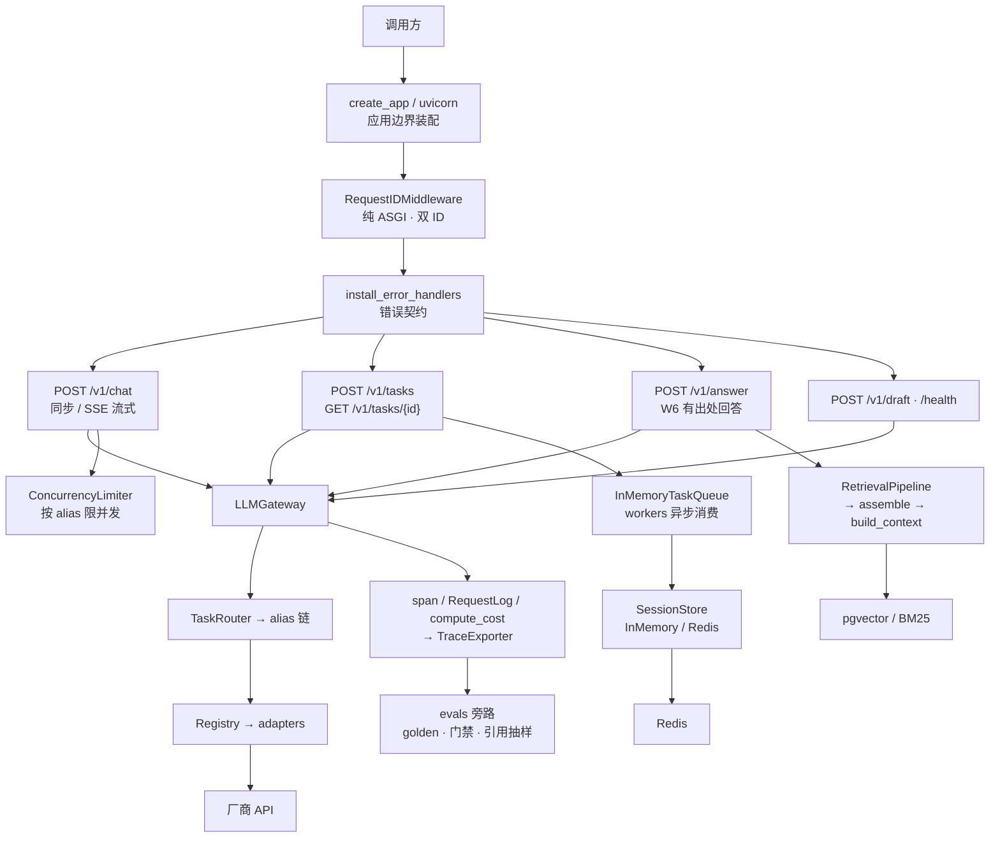
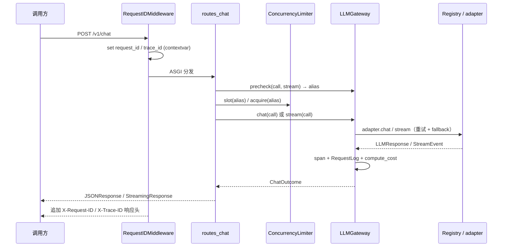
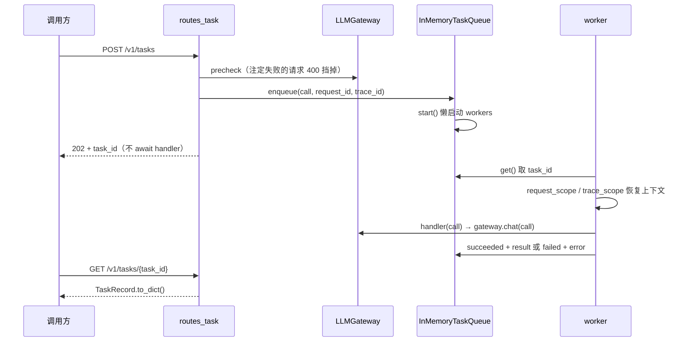
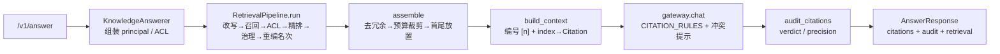

# server/question.md 逐题解答与整体架构

> 2026-11-07 编写。对应 `packages/agent_framework/src/agent_framework/server/question.md` 的全部问题，
> 以及其中两道动手题（W5/W6 类字段注释、整体架构图）。所有结论以当前代码为准，标注了文件与行号。

---

## 第 9 题：整体架构图

### 分层总览



四层职责：

| 层 | 组件 | 职责与边界 |
|---|---|---|
| 接入层 | `create_app` / `RequestIDMiddleware` / `install_error_handlers` | 装配、注入 ID、统一错误码。**不拼 prompt、不直连厂商** |
| 路由层 | `chat_router` / `task_router` / 产品层 `routes_answer` / `routes_draft` | 校验 body、投影内部类型、调 gateway、编码响应。**不做重试、不写业务逻辑** |
| 服务组件层 | `app.state` 五件套：gateway / limiter / task_queue / session_store / exporter | 全部可注入，测试与生产走同一条装配代码 |
| 基础设施层 | Registry + adapters、tracing/RequestLog、Redis、pgvector、evals | 协议翻译、观测、存储、评测旁路 |

`app.py` 模块头写死的四条禁令：拼 prompt、直连厂商 HTTP、在路由层做重试、把 `/v1/chat` 塞进任务队列。

### 请求时序 1：`/v1/chat`



流式分支的槽位在生成器 `finally` 里 `release`——客户端断开时生成器被关闭，漏还一次就永久少一个并发额度。

### 请求时序 2：`/v1/tasks`



### W5/W6 RAG 链路（挂在产品层，不进框架核心）



编号只能由 `build_context` 一个循环产出；之后任何移动/删除都会让答案里的 `[n]` 指错段。

---

## 第 1 题：RequestIDMiddleware 如何工作、运行时机是什么

**代码**：`server/middleware.py`（Day5 从 `app.py` 抽到独立文件，避免产品层 import 中间件时连带执行顶层 `app = create_app()`）。

它是一个**纯 ASGI 中间件**，实现 `__call__(scope, receive, send)`，不是 `@app.middleware("http")`：

1. `scope["type"] != "http"` 直接透传（websocket / lifespan 不处理）。
2. 从请求头取 `x-request-id` / `x-trace-id`，用 `ID_PATTERN = ^[A-Za-z0-9_-]{1,64}$` 校验；合法就透传，缺失或不合法就 `new_request_id()` / `new_trace_id()` 新建。**校验字符集是防日志注入与 Redis key 注入**。
3. `request_id_var.set(...)` / `trace_id_var.set(...)` 写入 contextvar，下游日志、trace、`RequestLog` 通过 `current_request_id()` 读取，不需要层层传参。
4. 包一层 `send_with_id`：只在 `message["type"] == "http.response.start"` 时用 `MutableHeaders.append` 追加 `X-Request-ID` / `X-Trace-ID`——响应头只在这个时机才能加。
5. `try/finally` 里 `reset(token)`，防止同一 task 上后续请求串号。

**为什么纯 ASGI**：`BaseHTTPMiddleware` 会把下游放进独立 task，`StreamingResponse` 的 body 迭代发生在 `call_next` 返回**之后**，contextvar 是否可见依赖实现细节；纯 ASGI 与业务在同一 task，行为确定。

**运行时机**：`app.add_middleware(RequestIDMiddleware)` 在 `create_app()` 时**注册**（模块导入时 `app = create_app()` 执行一次；测试里每次 create_app 各一次）。真正执行在**每个 HTTP 请求进入路由之前**，是 Starlette 中间件栈的最外层；响应头在 `http.response.start` 发出时注入。contextvar 覆盖整个请求生命周期，包括 SSE 流式迭代。

**两个 ID 的语义**：`request_id` = 一次 HTTP 请求（响应头回给调用方，用于对账"我看到的那次"）；`trace_id` = 一次用户任务（可跨多次 HTTP / 一次队列消费），调用方可透传做跨服务串联。

---

## 第 2 题：`include_router` 的两个 router 何时、如何被调度

先纠正一个常见误解：**`include_router` 不在请求时"调度"任何东西**，它也不"调用" router 对象。

- **注册时机**：`create_app()` 执行到 `app.include_router(chat_router)` / `app.include_router(task_router)` 时，FastAPI 把两个 `APIRouter` 里的 `APIRoute` **复制进 `app.router.routes`**，同时合并依赖、回调、生成 OpenAPI。这是启动期的一次性结构操作。
- **真正的调度时机**：请求到达后，uvicorn → ASGI 中间件栈 → Starlette `Router` 按 `routes` 注册顺序遍历，先按 path 模板匹配（含 `{task_id}` 路径参数），再按 HTTP method 匹配；命中后拿到 endpoint 函数（`chat` / `submit_task` / `get_task`），FastAPI 做依赖解析（见第 5 题）后 `await` 它。
- **匹配结果**：path 不匹配 → 404；path 匹配但 method 不匹配 → 405（由 Starlette 处理，不进 `install_error_handlers` 的异常映射）。
- **注册顺序**：chat_router（`/v1/chat`）→ task_router（`/v1/tasks`、`/v1/tasks/{task_id}`）→ `/health`。三者路径不重叠，顺序无歧义；若将来加 `/v1/chat/{id}` 这类重叠路由，顺序才会变重要。

---

## 第 3 题：chat_router 和 task_router 的关系

**两个彼此独立的 `APIRouter` 实例**，都由 `create_app()` 挂到同一个 `app` 上；彼此没有 import 关系、没有嵌套、没有调用关系。它们是"并列的两个入口"，共享的是下面这四样东西：

| 共享项 | 说明 |
|---|---|
| `app.state` | 同一个 gateway / limiter / task_queue / exporter / session_store |
| DTO | 都用 `ChatRequest` / `ChatResponse`；task 的 `make_task_handler` 也用 `ChatResponse.from_outcome` 投影 |
| 错误契约 | 同一个 `install_error_handlers(app)`，`BadRequestError`/`ServerBusyError` 等映射统一 |
| 中间件 | 同一套 request_id / trace_id |

**语义分工**（这才是关键）：

- `/v1/chat`：**实时通道**。同步 JSON 或 SSE 流式，在一次 HTTP 连接里跑完，占用 limiter 槽位，`body.stream=true` 时走 `StreamingResponse`。
- `/v1/tasks`：**异步通道**。校验 → 入队 → 立即 202 + `task_id`，稍后 `GET` 取结果；**明确拒绝 `stream=true`**（400），因为 SSE 连接不可能挂几分钟。

**边界纪律**：长任务绝不能塞进 HTTP 请求（客户端一断开协程被取消，几十秒工作白做）；反过来 `/v1/chat` 也绝不塞进队列（`app.py` 模块头明令禁止）。两者都先过 `gateway.precheck()`，把"alias 打错 / 不支持 tools"这类注定失败的请求在入口挡成 400，不让它占队列槽位排 30 秒。

---

## 第 4 题：`build_limiter` 为什么要放在 llmGateway 中；LLMGateway 的功能与属性

### 题目前提需要纠正：limiter 并不在 LLMGateway 里

`build_limiter` 定义在 `bootstrap.py`，产物挂在 **`app.state.limiter`**；路由层 `routes_chat._limiter(request)` 从 `request.app.state` 取，在调 `gateway.chat/stream` **之前**用 `limiter.slot(alias)` / `acquire(alias)`。

`bootstrap.py` 的 docstring 明确写了为什么**不放进** gateway：

> 在 gateway **之外**而不是之内：gateway 的职责是"把一次调用打出去"，入口过载属于服务层（谁收请求谁拒绝）。混进 gateway 会让"重试一次"与"重新排队一次"看起来像同一件事，而过载时最怕的就是这个。

具体风险：`gateway.chat` 内部有 `for attempt in range(max_attempts)` 重试循环和 fallback 候选链。若 limiter 在 gateway 内，拿不到槽位抛 `ServerBusyError` 会进入 `_should_retry` 判定，可能被当成上游错误重试或换候选重试，把"入口过载"放大成多倍流量；同时 503 + `Retry-After` 的语义（谁收请求谁拒绝）也退化了。另外两处位置要求：**在 gateway 之前**（避免重试放大）、**在 `StreamingResponse` 之前**（否则过载只能表现为"200 但流是空的"）。

如果题目指的是"为什么 `build_limiter` 与 `build_gateway` 放在同一个文件（bootstrap.py）"，答案是：`config.py` 不能 import `registry.py`（会形成 config → registry → providers → config 的环），而把组装逻辑塞进 `server/app.py` 会让测试无法只测"配置 + 路由 + 客户端"三层。所以单抽一个 `bootstrap.py` 作为**组装网关与限额的唯一入口**。

至于 `build_limiter(resolved_gateway.catalog, settings)` 用到 gateway 的参数：只是借它暴露的 **catalog** 读 `limits.limit_for(alias, provider)` 与 `max_inflight`，并不是把 limiter 装进 gateway。用同一份 catalog 而不是各自 load 一次，是"限额配置的唯一真相"。

### LLMGateway 提供哪些功能

外部可用的只有五个入口：

| 入口 | 作用 |
|---|---|
| `precheck(call, *, stream)` | 路由 + 能力校验，返回选中的 alias。**必须在构造 `StreamingResponse` 之前调用**：流式先发 header 再迭代 body，进了生成器任何错误都只能变成 200 + `event: error` |
| `chat(call)` | 非流式：`_plan` 出候选 alias 链 → 每候选能力校验 → 重试循环（指数退避 + 抖动、限流听上游 `Retry-After`）→ `adapter.chat` → 成功记 span / RequestLog / 成本 → 失败换 fallback → 全链失败抛 `LLMError` |
| `stream(call)` | 同上但按事件 `yield`；**首事件之前**失败可重试，`committed` 之后不再重试；`finally` 必须 `agen.aclose()`（否则连接池泄漏） |
| `catalog` / `settings` property | 给服务层读限额、价格表、能力；避免各自 load 一次 models.yaml |
| `aclose()` | 关 `_registry` 里的 httpx 连接池（lifespan 里"谁建谁关"） |

内部方法：`_plan`（结构校验，区分调用方拼错 alias→400 与配置坏→500 的归属）、`_tier`（日志用）、`_ensure_capabilities`（tools/stream 是硬需求，不满足直接 `CapabilityError`；`tool_choice` 是软策略，由 adapter 降级）、`_should_retry`（只认 `error.retryable` 一个字段，不重复写 `if status == 429`）、`_delay` / `_jitter`（抖动向下打散尖峰）、`_as_llm_error`（把 httpx 传输异常翻译成内部 `UpstreamTimeout/UpstreamServer`）、`_first_event`（首 token 超时；空流必须当错误）、`_mark_span_error`（失败 span 带 error_code，供 W4 按码归因）。

### 它保存的属性各自干什么

`__init__` 里六个字段全是私有的，服务层只能通过上面两个 property 读：

| 属性 | 含义 |
|---|---|
| `_registry` | adapter 注册表/工厂，持有各厂商客户端与 httpx 连接池；`get(alias)` 懒加载，启动时只做结构校验、不实例化 adapter（密钥缺失不挡启动） |
| `_router` | `TaskRouter`，把 `call.task`（chat / answer / judge / …）映射到 `models.yaml` 里的候选 alias 链（primary → fallback） |
| `_catalog` | 加载后的 `models.yaml`：models（价格/能力/厂商）、routes、tasks、limits；**所有路由与限额的唯一真相** |
| `_settings` | 运行参数：`max_attempts`、`backoff_base_s` / `backoff_cap_s`、`first_token_timeout_s` 等 |
| `_sleep` | 可注入的 `asyncio.sleep`，测试用假实现让退避不真等 |
| `_clock` | `time.perf_counter`，测延迟用；"延迟由网关测，不信上游"（`response.latency_ms` 由它覆盖） |

---

## 第 5 题：`chat(body: ChatRequest, request: Request)` 里的 body 和 request 如何被赋值

**都是 FastAPI 依赖注入，路由函数自己不解析任何东西**，两条通道独立：

- `body: ChatRequest`：参数类型是 pydantic `BaseModel` 子类且不是 Starlette 特殊类型 → FastAPI 把它判定为**请求体**：读取 request body → JSON 解析 → `ChatRequest.model_validate()`（含 `messages` 的 `min_length=1`、`model_validator` 的 tool_choice 联动校验、`max_tokens`/`temperature` 范围校验）→ 校验失败自动返回 422。函数拿到的是**已校验的实例**，不是 dict；随后 `body.to_call()` 投影成内部 `ChatCall`。
- `request: Request`：类型命中 Starlette 的 `Request` 特殊类型 → 注入**原始请求对象**（含 `app`、`state`、`headers`、`scope`、`client`），不参与 body 解析。路由靠它取 `request.app.state.gateway` / `limiter` / `task_queue`（`_gateway()` / `_limiter()` / `_queue()`）。

参数顺序不影响结果，FastAPI 按**类型标注**分别处理；同类还有路径参数（`get_task(task_id: str)` 从 `{task_id}` 取）与查询参数。这个设计的意义是：路由层不依赖全局变量，测试可以 `create_app(gateway=fake, ...)` 直接注入替身。

---

## 第 6 题：`build_session_store` 构建的 session 什么时候用到

**装配**：`create_app()` 里 `app.state.session_store = session_store or build_session_store(settings)`；`build_session_store` 按 `settings.session_backend` 选 `RedisSessionStore`（带 ttl / max_turns）或 `InMemorySessionStore`。**关闭**：lifespan 的 `finally` 里 `await app.state.session_store.aclose()`。

**但当前 HTTP 链路并没有消费它**——`/v1/chat`、`/v1/tasks`、`/v1/answer`、`/v1/draft` 都只调 gateway，没有读写会话。全库检索 `session_store` 只出现在 `app.py`、`session/` 三个文件、`tests/test_session.py` 与 `workflow/research_workflow.py` 的注释里。

这是 W2 定下的边界（`docs/w2/adr-w2-session-boundary.md`："/v1/chat 直连，长调研走 workflow"）刻意留下的位置：session 由 **W7 记忆模块 / W9 research_workflow** 消费；现在 `workflow/research_workflow.py` 只钉住 activity 的签名，并引用 `SessionStore.append` 的幂等键纪律（Temporal 至少一次投递）。也就是说它目前是"**装配好、可注入、有单测、等接入**"的状态。

契约（`session/base.py`）：`get_history(session_id) -> list[Message]`、`append(session_id, messages, request_id=None) -> bool`（True=真写入，False=幂等命中；同一 request_id 重复 append 不能让历史翻倍）、`aclose()`；`encode_turn` / `decode_turn` 放在契约层统一内部存储格式，避免第二个实现复制时漏带 `provider_meta`。`create_app(session_store=...)` 可注入让测试用内存、生产用 Redis 走同一条装配代码，避免"测试走一条路、生产走另一条"的假绿。

---

## 第 7 题：`submit_task` 提交的任务如何执行

1. **入口**（`routes_task.submit_task`）：拒绝 `stream=true`（400）→ `body.to_call()` → `_gateway.precheck(call, stream=False)`（注定失败的请求在入队前 400 挡掉）→ `_queue.enqueue(call, request_id=current_request_id(), trace_id=current_trace_id())` → 返回 **202** + `task_id` + `X-Task-ID`。**不 await handler**。
2. **入队**（`queue/inmemory.py.enqueue`）：先 `await start()` 懒启动 workers（带 `_start_guard` Lock 防重复；`create_app()` 时 import 不建后台 task，测试可以"只入队不消费"断言 queued）→ 生成 `task_<uuid12>` 的 `TaskRecord(status=queued)` → **先登记 `_records` / `_calls` 再 `put_nowait`**（反序会让跑得快的消费者查不到 id，任务被静默丢掉，记录永远停在 queued）→ 队满抛 `ServerBusyError(503 + Retry-After)` 并回滚两条登记 → `_prune()` 只保留最近 `retention` 条已完成记录，防内存缓慢上涨。
3. **消费**（`_worker` / `_run_one`）：worker 是 `asyncio.Task` 不是后台线程（`LLMGateway` 是 async，线程池里调只会浪费事件循环并发能力）。`while True: task_id = await _pending.get()`，然后：
   - `with request_scope(record.request_id), trace_scope(record.trace_id)` **恢复上下文**——消费者不在任何 HTTP 上下文里，不显式进 scope 会让任务内部的 LLM 调用产出空 trace_id，trace 从这里断掉；
   - `status=running`、`started_at`；
   - `await handler(call)`，handler 就是 `make_task_handler(gateway)` 返回的闭包：`gateway.chat(call)` → `ChatResponse.from_outcome(...).model_dump()` 投影成 dict（**投影放在 handler 而不是队列里**，队列不该知道对外 DTO）；
   - 成功 → `succeeded` + `result`；`LLMError` → `failed` + `{code, message, provider}`；其他 `Exception` → `failed` + `INTERNAL`。**失败不 raise**：它是这个任务的结果，不是异常；
   - `finally` 记 `finished_at`、清 `_calls`；外层 `task_done()`。
4. **查询**：`GET /v1/tasks/{task_id}` 读 `_records` 返回 `TaskRecord.to_dict()`；查不到抛 `TaskNotFoundError(404)`。
5. **状态机**：`queued → running → succeeded / failed`，只有四条边；`attempts` 恒为 1，真正的分步重试归 W9 的 Temporal。
6. **关闭**：lifespan `finally` → `aclose()` cancel 所有 worker 并 `gather(return_exceptions=True)`。

---

## 第 8 题：除 InMemoryTaskQueue 外还有其他实现吗？如何接入

**没有其他实现**。`queue/` 下只有 `base.py`（`TaskQueue` Protocol + `TaskRecord` / `TaskStatus` / `TaskHandler`）与 `inmemory.py`（唯一实现），`__init__.py` 只导出这两者。W9 换 Temporal/arq 是计划项，不是现状。

契约是 **Protocol（结构化子类型，不需要继承）**：

```python
class TaskQueue(Protocol):
    async def enqueue(self, call: ChatCall, *, request_id: str | None = None,
                      trace_id: str | None = None) -> TaskRecord: ...
    async def get(self, task_id: str) -> TaskRecord: ...
    async def aclose(self) -> None: ...
```

**接入方式**：`create_app(..., task_queue=my_queue)` 注入（`app.py:49, 88`）。路由层 `_queue()` 只判 None、不做 `isinstance` 检查，所以任何满足三方法的对象都能直接换。测试里已有先例：`tests/test_tasks_api.py:145` 注入 `InMemoryTaskQueue(slow_handler, max_size=1, workers=1)`。

实现 Redis / arq 版的最小清单：

1. `enqueue` 把 `ChatCall`（messages / tools / opts / model / task）与两个 ID 一起序列化进共享存储，返回 `queued` 的 `TaskRecord`；保留"先登记再入队"与"队满 503 + Retry-After"的语义。
2. `get` 从共享存储读；未知 id 抛 `TaskNotFoundError`（否则 `/v1/tasks/{id}` 会返回 500 而不是 404）。
3. **消费者在独立进程时**（arq worker / Celery），要把 `make_task_handler(gateway)` 的逻辑复制成 worker 侧函数，并在消费时用 `request_scope` / `trace_scope` 恢复上下文——这是最常被漏掉的一条。
4. 保持状态机与错误码一致（`LLMError` → `{code, message, provider}`），否则评测的失败归因分类会失效。
5. `aclose()` 关连接池。`/health` 目前只对 `InMemoryTaskQueue` 出 `snapshot()`，其他实现回退为 `{"backend": type(queue).__name__}`（`app.py:114-118`）；`snapshot()` 不是契约要求，可按需扩展。
6. **多副本部署必须换掉 InMemory**：它每个副本各跑各的消费者，任务不跨实例共享，`GET` 打到另一个副本就是 404（类 docstring 已明示）。

---

## 第 9 题（原文第二个 7）：重写查询不能在 `06_rag/rag_mvp/src/rag_mvp/pre_query` 中实现吗

先区分两件事：

- rag_mvp 的 `pre_query/normalizer.py` 只有一个 `normalize_query`：**NFKC 归一化 + 空白折叠 + 最大长度校验**，是格式清洗。
- 框架的 `retrieval/query_rewrite.py` 有 `MultiQueryRewriter` / `HydeRewriter`：**打 LLM 生成等价查询 / 假设答案**，是语义扩展。

`docs/w5/rag-mvp-reuse-assessment.md:45` 已判定"pre_query/ 只有 normalize_query，**不是改写**"；`docs/w5/rag-mvp-copy-plan.md:41` 的迁移结论是"只留 NFKC；multi-query 新写"。

**技术上能**：如果只是想在 rag_mvp 里做对照实验（复用它的 `golden_queries.yaml` 跑 A/B），完全可以在 `pre_query/rewriter.py` 里写；reuse-assessment 第 139 行正是这么建议的（改写失败回退原 query、去重后并发召回、token 成本可记）。

**但不能作为本项目框架的生产落点**，五条理由：

1. **依赖方向反了**：`packages/agent_framework` 是产品框架，`06_rag/rag_mvp` 是早期教学/素材项目（主仓已迁走，只剩 `.tmp/sim*` 快照）。copy-plan 的验收判据明确要求 `packages/` 里不能出现 `from ... pre_query import`。框架反向依赖教学项目等于把边界画反。
2. **依赖重量**：rag_mvp 带 torch / sentence-transformers 等本地模型依赖；框架包纪律是"零第三方依赖（只有 pydantic + 标准库）"，不能因为要接 RAG 就让所有引用框架的项目背 2GB（`knowledge/base.py` 模块头）。
3. **改写必须走网关**：`MultiQueryRewriter` 调 `LLMGateway.chat()`，从 `catalog.routes["cheap"].primary` 取模型，复用重试 / fallback / 计费 / span / RequestLog。rag_mvp 没有网关，自己直连厂商就绕开了 ADR-003「重试只在 client」这条纪律。
4. **降级、预算、诊断都在框架侧**：`RetrievalPipeline._rewrite` 统一管超时降级（`rewrite_degraded`）、单 deadline 递减、`RewriteUsage` 成本累计；W5 的 A/B 要回答"这点召回提升值不值这个钱"（实测结论：**默认关改写**，两次运行都不如不改，p95 15.2s、约 3.55 元/千次检索）。这些指标住在框架与 evals 层，放 rag_mvp 就断链了。
5. **契约对不齐**：框架 `QueryRewriter` Protocol 要求"返回的第一条必须是原查询"（保证改写变差不会比不改更糟），`_recall` 并发多查询后由 `reciprocal_rank_fusion` 融 N 路，`RetrievalDiagnostics.queries` 记录实际用了哪些查询，供 W4 归因与 W6 引用链路消费。rag_mvp 的 RRF 只融 dense/sparse 两路，且用自己的 `RetrievalResult` 类型。

**结论**：NFKC 归一化可以复用/照搬，**语义改写必须在框架侧新写**；rag_mvp 只适合当"对照实验田"，实验结论再回填框架（W5 就是这么做的，结论是默认关闭改写）。

---

## 第 10 题（原文 8）：给 W5/W6 用到的类添加字段注释

已完成，共 **13 个文件**，风格与此前 W3/W4 一致：逐字段解释"它是什么、为什么存在、误用会怎样"，并纠正了一处文档与代码不一致。

框架侧：

| 文件 | 补注释的类/字段 |
|---|---|
| `retrieval/pipeline.py` | `RetrievalDiagnostics`（query / reranked / degraded / recall_ms / rerank_ms / total_ms）、`RetrievalOutcome`（chunks / diagnostics）、`RetrievalPipeline.__init__` 全部 10 个属性 |
| `retrieval/query_rewrite.py` | `RewriteUsage` 全部字段、`_GatewayRewriter.__init__` 属性 |
| `retrieval/context_assemble.py` | `DedupeResult` / `TrimResult` / `AssembledContext` 全部字段 |
| `retrieval/acl.py` | `Principal` / `ACLDecision` / `ACLPolicy` 全部字段 |
| `knowledge/base.py` | `Chunk.text`、`ScoredChunk.chunk` / `score` |
| `knowledge/citation.py` | `Citation` / `CitationContext` / `ParsedCitations` / `CitationExpectation` / `CitationAudit` 全部字段 |
| `knowledge/governance.py` | `GovernancePolicy` 全部 6 个字段 |
| `knowledge/incremental.py` | `DocVersion` / `SyncResult` 全部字段、`IncrementalIndexer.__init__` 属性 |

产品层与评测层：

| 文件 | 补注释的类/字段 |
|---|---|
| `apps/growth_agent/src/growth_agent/answer.py` | `KnowledgeAnswer` 全部字段、`KnowledgeAnswerer.__init__` 属性 |
| `apps/growth_agent/src/growth_agent/rag.py` | `RagRuntime` 全部字段 |
| `apps/growth_agent/src/growth_agent/routes_answer.py` | `AnswerRequest` / `AnswerResponse` 全部字段 |
| `apps/growth_agent/src/growth_agent/routes_draft.py` | `DraftRequest` / `DraftResponse` 全部字段 |
| `evals/scripts/citation_accuracy.py` | `Sample` / `CaseResult` 全部字段 |

**顺带修正**：`retrieval/acl.py` 模块 docstring 第 2 条仍写"过滤发生在精排之后、进 context 之前"，与 W6 已落地的代码相反。现改为与 `pipeline.py` 一致的"ACL 在精排之前"，并写明两个理由（省 4.7s 精排算力；**更重要的侧信道**——精排耗时随无权限块数量变化，会让无权限调用方推断库里有多少他看不到的文档）。

**验证**：`.venv/bin/ruff check` 全绿；`mypy` 62 个源文件 0 问题；`pytest -q` 全量 0 失败（原有 skip 保持不变）。

---

## 第 11 题（原文 9）：整体架构图

见本文档开头的分层总览图、两条请求时序图、RAG 链路图；对话中另有两张内联可视化图（整体分层架构、W5/W6 五步链路）。
