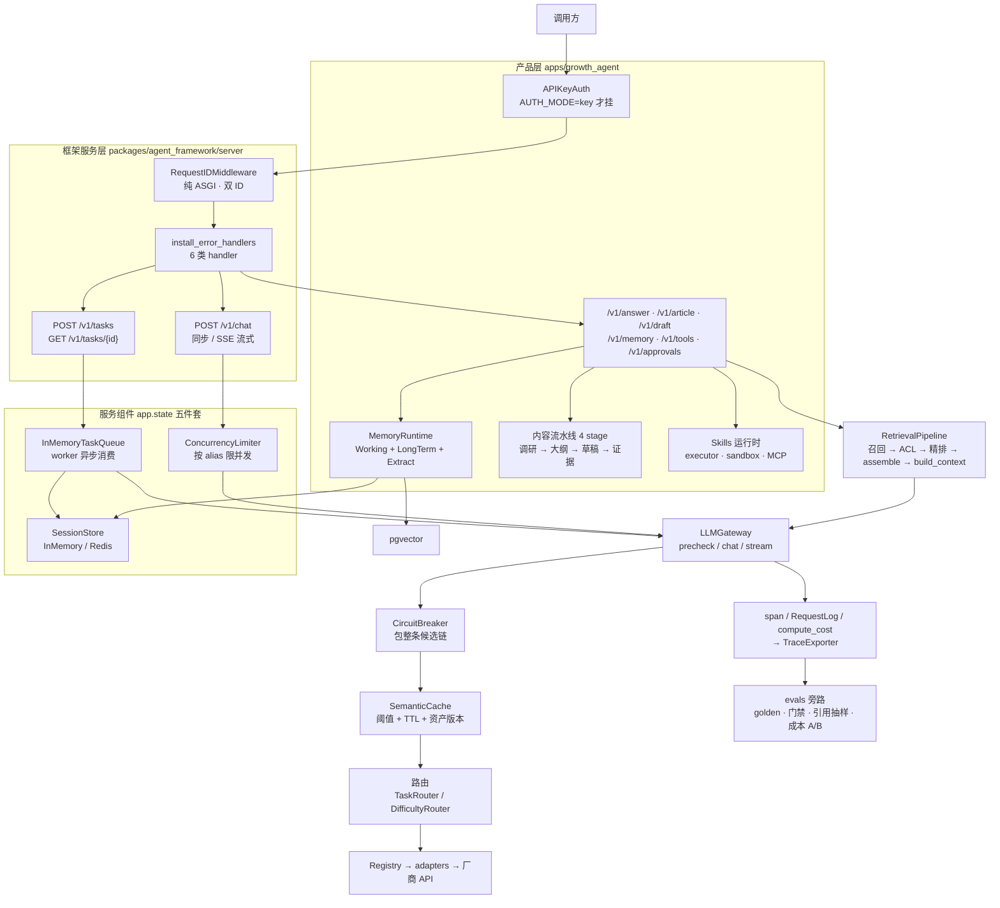
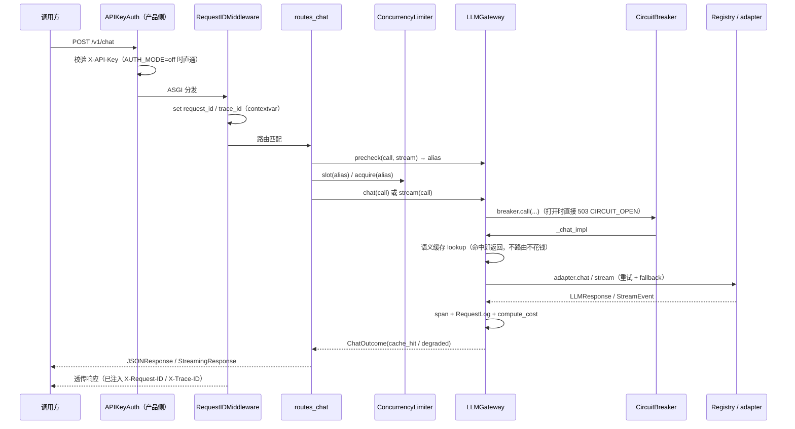
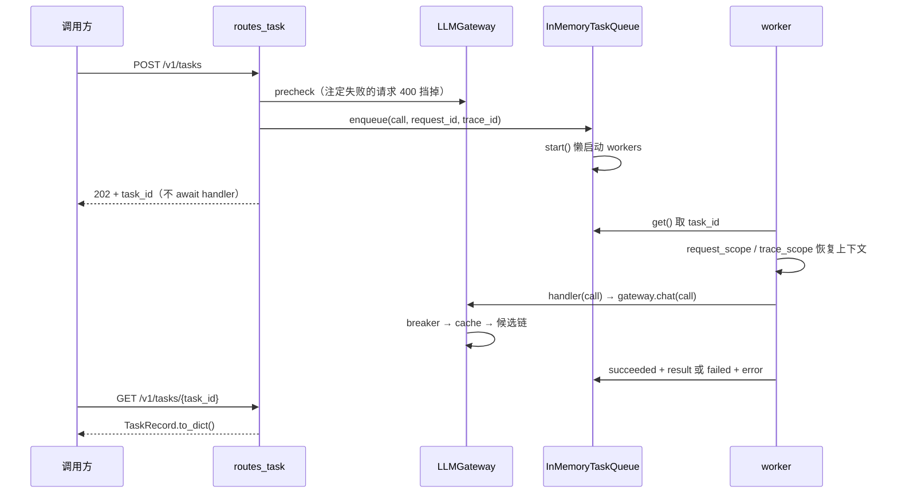

# server/question.md 逐题解答与整体架构

> 初版 2026-11-07（W6 末），**2026-11-16 按 W1–W12 最终实现复核**。
> 对应 `packages/agent_framework/src/agent_framework/server/question.md` 的全部问题
> （原文有重号，本文统一按「原文第 N 问」标注），以及两道动手题（W5/W6 字段注释、整体架构图）。
>
> 结论以当前代码为准。**行号会漂移，函数名不会**——先按函数名找，行号只作近似定位。

---

## 本轮更新摘要（相对 11-07 初版）

| 问 | 初版结论 | 现在的事实 | 依据 |
|---|---|---|---|
| 原文第 1 问 | 模块导入时执行一次 `app = create_app()` | **W12 起改为 PEP 562 惰性属性**，`import` 不再构造应用；产品侧鉴权挂在 RequestID **内侧** | `server/app.py:_app/__getattr__`、`growth_agent/app.py:96-101` |
| 原文第 2 问 | 只提框架的两个 router | 框架 2 个 router + `/health`；产品 5 个 router；`add_middleware` 的「后加更外层」决定了鉴权与请求 ID 的顺序 | `server/app.py:94-97`、`growth_agent/app.py:100-107` |
| 原文第 3 问（第一个） | 两 router 共享四样 | 共享清单未变，但**两条通道都不承担会话**；会话在产品的 `/v1/answer`（W7） | `server/routes_*.py`、`growth_agent/answer.py` |
| 原文第 3 问（第二个） | gateway 五个入口 / 六个私有字段 | **六个入口 / 八个私有字段**：新增 `_breaker`、`_cache`；`chat()` 被熔断器包住，`_chat_impl` 里多一层语义缓存 | `llm/client.py` |
| 原文第 4 问 | 校验失败「自动返回 422」 | **错**：我方 `install_error_handlers` 把 `RequestValidationError` 映射成 400 `BAD_REQUEST` | `server/errors.py:_on_validation_error` |
| 原文第 5 问 | 「装配好、等接入」 | 已被 W7 `WorkingMemory` 消费，但消费方是**产品** `/v1/answer`，且它自建 store——当前有**两处** `build_session_store` | `memory/working.py`、`growth_agent/memory.py:build_memory_runtime` |
| 原文第 6 问 | 失败体 `{code, message, provider}` | `code` 现在由 `error_code_for()` 出；熔断打开时任务以 `CIRCUIT_OPEN` 结束 | `queue/inmemory.py:_run_one` |
| 原文第 7 问（一） | 队列只有 InMemory 实现 | **仍然是**。W9 没有换成 Temporal，`workflow/research_workflow.py` 仍是签名缝 | `queue/`、`workflow/research_workflow.py` |
| 原文第 7 问（二，原文重号） | 语义改写必须在框架侧 | **不变**；默认关（`retrieval_rewrite=False`），实验结论仍是不如不改 | `config.py`、`docs/w5/rag-ab-report.md` |
| 原文第 8 问（字段注释） | 13 个文件 | 那 13 个仍有效，另补了 **W7–W12 新增字段表** | 本文末节 |
| 原文第 9 问（架构图） | 框架侧四层 | 换成**产品层 + 框架层**的六层图，含熔断/缓存/记忆/防护 | 本文首节、`docs/architecture-diagram.md` |

---

## 原文第 9 问：整体架构图

### 分层总览



六层职责：

| 层 | 组件 | 职责与边界 |
|---|---|---|
| 产品层 | `growth_agent.create_app` / 5 个 router | 决定策略：检索要不要开、记忆要不要开、哪些动作要审批。**框架不替产品决定这些** |
| 接入层 | `APIKeyAuth` / `RequestIDMiddleware` / `install_error_handlers` | 认证、注入 ID、统一错误码。**不拼 prompt、不直连厂商** |
| 路由层 | 框架 `chat_router` / `task_router`；产品各 `routes_*` | 校验 body、投影内部类型、调 gateway、编码响应。**不做重试、不写业务逻辑** |
| 服务组件层 | `app.state` 五件套：gateway / exporter / session_store / limiter / task_queue | 全部可注入，测试与生产走同一条装配代码 |
| LLM 链路层 | `LLMGateway` → breaker → cache → router → registry → adapter | 重试、退避、fallback、熔断、缓存、计量。**重试的唯一主人**（ADR-003） |
| 基础设施层 | Redis、pgvector、tracing/RequestLog、evals 旁路 | 协议翻译、观测、存储、评测 |

`app.py` 模块头写死的四条禁令（仍然有效）：拼 prompt、直连厂商 HTTP、在路由层做重试、把 `/v1/chat` 塞进任务队列。

W12 之后还有三条**装配层**纪律，属于「代码看不出来、出事才发现」那类：

1. **产品代码只用公共面**（`docs/w12/framework-api.md`）。`apps/` 已无一处穿透实现模块，
   `evals/scripts/w12/api_audit.py --check` 守着；复用到实现模块意味着改一次内部结构就要改产品。
2. **鉴权加在 RequestID 之前**。Starlette 的 `add_middleware` 是「后加的更外层」，
   所以产品先 `install_api_key_auth` 再 `add_middleware(RequestIDMiddleware)`，
   401 响应体里才有 `request_id`——而排障时最需要它的恰恰是被拒的那批请求。
3. **`create_app` 是纯函数，模块级 `app` 是惰性属性**。想自己装配服务的调用方，
   不该为了 import 一个符号而先建出一个连着资源池的应用（W12 D2 的副作用清理）。

### 请求时序 1：`/v1/chat`



两处顺序不能挪：

- **槽位在 `StreamingResponse` 之前拿**。进了生成器再报过载，只能变成「200 但流是空的」。
- **流式槽位在生成器 `finally` 里还**。客户端断开时生成器被关闭，漏还一次就永久少一个并发额度。

### 请求时序 2：`/v1/tasks`



### `/v1/answer`：检索 + 引用 + 记忆（产品层，不进框架核心）

```mermaid
flowchart LR
    A["/v1/answer"] --> B["KnowledgeAnswerer<br/>建 principal / ACL"]
    B --> C["RetrievalPipeline.run<br/>改写→召回→ACL→精排→治理→重编名次"]
    C --> D["assemble<br/>去冗余→预算裁剪→首尾放置"]
    D --> E["build_context<br/>编号 [n] + index→Citation"]
    E --> F["记忆注入（W7，MEMORY=governed）<br/>recall_for_query + session_view"]
    F --> G["gateway.chat<br/>CITATION_RULES + 冲突提示"]
    G --> H["记忆落地（W7）<br/>record_turn：追加→压缩→按需提取"]
    H --> I["audit_citations<br/>verdict / precision"]
    I --> J["AnswerResponse<br/>citations + audit + retrieval + memory_keys"]
```



编号只能由 `build_context` 一个循环产出；之后任何移动/删除都会让答案里的 `[n]` 指错段。
记忆与检索**各自占预算槽位**（`MEMORY_SLOT_TOKENS`），不互相抢——否则「命中更多资料」会悄悄挤掉「记住的品牌调性」。

---

## 原文第 1 问：RequestIDMiddleware 如何工作、运行时机是什么

**代码**：`server/middleware.py`。Day5 从 `app.py` 抽成独立文件，避免产品层为了拿一个中间件而连带启动一个框架应用。

它是一个**纯 ASGI 中间件**，实现 `__call__(scope, receive, send)`，不是 `@app.middleware("http")`：

1. `scope["type"] != "http"` 直接透传（websocket / lifespan 不处理）。
2. 从请求头取 `x-request-id` / `x-trace-id`，用 `ID_PATTERN = ^[A-Za-z0-9_-]{1,64}$` 校验；合法就透传，缺失或不合法就 `new_request_id()` / `new_trace_id()` 新建。**校验字符集是防日志注入与 Redis key 注入**。
3. 写入 `request_id_var` / `trace_id_var`（contextvar）。下游日志、span、`RequestLog`、SSE 帧都通过 `current_request_id()` 读，不需要层层传参。
4. 包一层 `send_with_id`：只在 `message["type"] == "http.response.start"` 时用 `MutableHeaders.append` 追加 `X-Request-ID` / `X-Trace-ID`——响应头只有这个时机能加。
5. `try/finally` 里 `reset(token)`，防止同一 task 上后续请求串号。

**为什么纯 ASGI**：`BaseHTTPMiddleware` 会把下游放进独立 task，`StreamingResponse` 的 body 迭代发生在 `call_next` 返回**之后**，contextvar 是否可见依赖实现细节；纯 ASGI 与业务在同一 task，行为确定。

**注册时机与执行时机**（W12 有变化）：

- **注册**：`create_app()` 里 `app.add_middleware(RequestIDMiddleware)`，一次。
- **模块级 `app` 不再是 import 副作用**（W12 D2）：`server/app.py` 里改成
  ```python
  _app: FastAPI | None = None

  def __getattr__(name: str) -> Any:
      global _app
      if name == "app":
          if _app is None:
              _app = create_app()
          return _app
      raise AttributeError(...)
  ```
  `uvicorn agent_framework.server.app:app` 与 `from ... import app` 照旧可用——它们本就是「取属性」，只是生成时机从 import 挪到第一次被取。`main()` 用工厂字符串 `...:create_app`（`factory=True`），`--reload` / 多 worker 时由 uvicorn 在子进程里构造。
- **执行**：每个 HTTP 请求进入路由之前，Starlette 中间件栈的**最外层**（除产品侧鉴权）。
  产品应用里 `install_api_key_auth(app)` **先**加、`add_middleware(RequestIDMiddleware)` **后**加，
  因为「后加的更外层」——所以最终 RequestID 在外、鉴权在内：被 401 拒掉的请求也有 request_id。

**两个 ID 的语义**：`request_id` = 一次 HTTP 请求（响应头回给调用方，用于对账"我看到的那次"）；`trace_id` = 一次用户任务（可跨多次 HTTP / 一次队列消费），调用方可透传做跨服务串联。

---

## 原文第 2 问：`include_router` 的两个 router 何时、如何被调度

先纠正一个常见误解：**`include_router` 不在请求时"调度"任何东西**，它也不"调用" router 对象。

- **注册时机**：`create_app()` 执行到 `app.include_router(chat_router)` / `app.include_router(task_router)` 时，FastAPI 把两个 `APIRouter` 里的 `APIRoute` **复制进 `app.router.routes`**，合并依赖与回调、生成 OpenAPI。这是启动期的一次性结构操作。
- **真正的调度时机**：请求到达后 uvicorn → ASGI 中间件栈 → Starlette `Router` 按 `routes` 注册顺序遍历，先按 path 模板匹配（含 `{task_id}` 路径参数），再按 method 匹配；命中后拿到 endpoint 函数（`chat` / `submit_task` / `get_task`），FastAPI 做依赖解析（见原文第 4 问）后 `await` 它。
- **匹配结果**：path 不匹配 → 404；path 匹配但 method 不匹配 → 405（Starlette 处理，不进我们的异常映射）。
- **注册顺序**：框架侧 chat_router（`/v1/chat`）→ task_router（`/v1/tasks`、`/v1/tasks/{task_id}`）→ `/health`（`@app.get`，直接在 app 上）。三者路径不重叠，顺序无歧义。

**当前实际的 router 清单**（这条容易只看到框架的两个）：

| 应用 | router | 端点 |
|---|---|---|
| 框架 `agent_framework.server.create_app` | `chat_router` / `task_router` / 内联 `/health` | `/v1/chat`、`/v1/tasks`、`/v1/tasks/{id}`、`/health` |
| 产品 `growth_agent.create_app` | `draft` / `answer` / `memory` / `tools` / `article` | `/v1/draft`、`/v1/answer`、`/v1/memory`、`/v1/tools*`、`/v1/approvals*`、`/v1/article`、`/health` |

两个应用**各自 `create_app`**，产品不经过框架的 `create_app`（只复用中间件、错误契约、鉴权与 gateway）。这也是原文第 5 问里「两处 `build_session_store`」的根源。

---

## 原文第 3 问：chat_router 和 task_router 的关系

**两个彼此独立的 `APIRouter` 实例**，都由 `create_app()` 挂到同一个 `app`；彼此没有 import、嵌套、调用关系。共享的是四样：

| 共享项 | 说明 |
|---|---|
| `app.state` | 同一个 gateway / exporter / limiter / task_queue / session_store |
| DTO | 都用 `ChatRequest` / `ChatResponse`；task 的 `make_task_handler` 也用 `ChatResponse.from_outcome` 投影 |
| 错误契约 | 同一个 `install_error_handlers(app)`（6 类 handler，见原文第 4 问） |
| 中间件 | 同一套 request_id / trace_id |

**语义分工**（这才是关键）：

- `/v1/chat`：**实时通道**。同步 JSON 或 SSE 流式，一次 HTTP 连接里跑完，占 limiter 槽位。
- `/v1/tasks`：**异步通道**。校验 → 入队 → 立即 202 + `task_id`，稍后 `GET` 取结果；**明确拒绝 `stream=true`**（400）。

**边界纪律**：长任务绝不能塞进 HTTP 请求（客户端一断开协程被取消，几十秒工作白做）；`/v1/chat` 也绝不塞进队列（`app.py` 模块头明令禁止）。两者都先 `gateway.precheck()`，把「alias 打错 / 不支持 tools」这类注定失败的请求在入口挡成 400，不让它占队列槽位排 30 秒。

**一处容易被误判的空白**：两条通道都**不读写会话**。会话在 `/v1/answer`（W7 记忆链路），
框架那份 `app.state.session_store` 至今没有消费方——见原文第 5 问。
看到「服务组件五件套里有 session_store」就以为 `/v1/chat` 会带上下文，是最常见的误解。

---

## 原文第 3 问（原题第二个问题）：`build_limiter` 为什么不在 LLMGateway 中；LLMGateway 的功能与属性

### 题目前提需要纠正：limiter 并不在 LLMGateway 里

`build_limiter` 定义在 `bootstrap.py`，产物挂在 **`app.state.limiter`**；`routes_chat._limiter(request)` 从 `request.app.state` 取，在调 `gateway.chat/stream` **之前**用 `limiter.slot(alias)` / `acquire(alias)`。

`bootstrap.build_limiter` 的 docstring 明确写了为什么**不放进** gateway：

> 在 gateway **之外**而不是之内：gateway 的职责是"把一次调用打出去"，入口过载属于服务层（谁收请求谁拒绝）。混进 gateway 会让"重试一次"与"重新排队一次"看起来像同一件事，而过载时最怕的就是这个。

具体风险：`gateway.chat` 内部有 `for attempt in range(max_attempts)` 重试循环与 fallback 候选链。若 limiter 在 gateway 内，拿不到槽位抛 `ServerBusyError` 会进入 `_should_retry` 判定，可能被当成上游错误重试或换候选重试，把「入口过载」放大成多倍流量；503 + `Retry-After` 的语义（谁收请求谁拒绝）也退化了。另外两处位置要求：**在 gateway 之前**（避免重试放大）、**在 `StreamingResponse` 之前**（否则过载只能表现为「200 但流是空的」）。

如果题目问的是「为什么 `build_limiter` 与 `build_gateway` 放在同一个文件」：`config.py` 不能 import `registry.py`（会形成 config → registry → providers → config 的环），而把组装逻辑塞进 `server/app.py` 会让测试无法只测「配置 + 路由 + 客户端」三层。所以单抽 `bootstrap.py` 作为**组装链路与限额的唯一入口**。

`build_limiter(resolved_gateway.catalog, settings)` 借的是 gateway 暴露的 **catalog**（读 `limits.limit_for(alias, provider)` 与 `max_inflight`），不是把 limiter 装进 gateway。同一份 catalog 而不是各自 load 一次，是「限额配置的唯一真相」。

**一个已知近似**：槽位按 `precheck` 返回的 primary alias 记。若内部 fallback 到另一个 alias，槽位仍挂在 primary 上——
这是刻意选择（一次请求只占一个槽），代价是「primary 与 fallback 的配额互相借用」，而不是「一次请求卡两个槽」造成死锁。

### LLMGateway 提供哪些功能

外部可用的只有六个入口：

| 入口 | 作用 |
|---|---|
| `precheck(call, *, stream)` | 路由 + 能力校验，返回选中的 alias。**必须在构造 `StreamingResponse` 之前调用**：流式先发 header 再迭代 body，进了生成器任何错误都只能变成 200 + `event: error` |
| `chat(call)` | 非流式。W11 起**熔断器的唯一挂载点**：`self._breaker is None` 时直通，否则 `breaker.call(lambda: self._chat_impl(call))`。打开期间抛 `CircuitOpenError`（503 `CIRCUIT_OPEN`），不进候选链 |
| `stream(call)` | 按事件 `yield`；**首事件之前**失败可重试，`committed` 之后不再重试；`finally` 必须 `agen.aclose()`（否则连接池泄漏） |
| `catalog` / `settings` property | 给服务层读限额、价格表、能力；避免各自 load 一次 models.yaml |
| `aclose()` | 关 `_registry` 里的 httpx 连接池（lifespan 里「谁建谁关」） |

`_chat_impl` 的内部顺序是**缓存 → 路由 → 候选链 → 重试 → adapter**：

1. **语义缓存**（W11）。命中就不路由、不花钱、不打上游；返回的 `ChatOutcome` 带 `cache_hit=True`。缓存挂在**熔断器之内**，所以命中不消耗熔断配额——一个已被上游打成 OPEN 的系统，仍应能靠缓存返回老答案。
2. `_plan` 出候选 alias 链（`call.model` 优先，否则走路由）。
3. 每个候选：能力校验 → 内层 `for attempt in range(max_attempts)` → 指数退避 + 抖动（限流听上游 `Retry-After`）→ `adapter.chat` → 成功记 span / RequestLog / 成本 → 失败换 fallback → 全链失败抛最后一次真实 `LLMError`（不造新错）。

内部方法：`_plan`（结构校验，区分「调用方拼错 alias → 400」与「配置坏 → 500」）、`_tier`（日志用）、`_route`（`getattr(self._router, "route_for", None)` 探测——`DifficultyRouter` 有此方法，`TaskRouter` 没有，所以分流器是**可选增强**，关掉即回到 W10 行为）、`_ensure_capabilities`（tools/stream 是硬需求，不满足直接 `CapabilityError`；`tool_choice` 是软策略，由 adapter 降级）、`_should_retry`（只认 `error.retryable` 一个字段）、`_delay` / `_jitter`（抖动向下打散尖峰）、`_as_llm_error`（httpx 传输异常 → 内部 `UpstreamTimeout/UpstreamServer`）、`_first_event`（首 token 超时；空流必须当错误）、`_mark_span_error`（失败 span 带 error_code，供 W4 按码归因）、`_cacheable` / `_cache_key` / `_cache_lookup` / `_cache_store` / `_emit_cache_hit`。

### 它保存的属性各自干什么

`__init__` 里**八个字段全是私有的**，服务层只能通过上面两个 property 读：

| 属性 | 含义 |
|---|---|
| `_registry` | adapter 注册表/工厂，持有各厂商客户端与 httpx 连接池；`get(alias)` 懒加载，启动时只做结构校验、不实例化 adapter（密钥缺失不挡启动） |
| `_router` | `TaskRouter` 或 `DifficultyRouter`，把 `call.task` 映射到 `models.yaml` 的候选 alias 链（primary → fallback） |
| `_catalog` | 加载后的 `models.yaml`：models（价格/能力/厂商）、routes、tasks、limits；**所有路由与限额的唯一真相** |
| `_settings` | 运行参数：`max_attempts`、`backoff_base_s` / `backoff_cap_s`、`first_token_timeout_s` 等 |
| `_sleep` | 可注入的 `asyncio.sleep`，测试用假实现让退避不真等 |
| `_clock` | `time.perf_counter`；延迟由网关测，不信上游（`latency_ms` 由它覆盖） |
| `_breaker` | W11：熔断器，`None` = 直通（`BREAKER_ENABLED=false` 时的行为与 W10 一字不差） |
| `_cache` | W11：语义缓存，`None` = 不缓存（`FEATURES` 里没开 `semantic_cache` 时的默认） |

**为什么熔断器在 gateway 里、limiter 不在**：limiter 是「入口收不收这个请求」，熔断是「上游还能不能打」——
后者是链路自己的事，放在 4 个业务调用点意味着新增一个调用点就漏一个；前者放进来则会把「过载」变成「重试」。

---

## 原文第 4 问：`chat(body: ChatRequest, request: Request)` 里的 body 和 request 如何被赋值

**都是 FastAPI 依赖注入，路由函数自己不解析任何东西**，两条通道独立：

- `body: ChatRequest`：参数类型是 pydantic `BaseModel` 子类且不是 Starlette 特殊类型 → FastAPI 判定为**请求体**：读 body → JSON 解析 → `ChatRequest.model_validate()`（`messages` 的 `min_length=1`、`tool_choice_name` 联动校验、`max_tokens>0`、`0≤temperature≤2`）→ 失败走异常路径。函数拿到的是**已校验实例**，不是 dict；随后 `body.to_call()` 投影成内部 `ChatCall`。
- `request: Request`：命中 Starlette 的 `Request` 特殊类型 → 注入**原始请求对象**（含 `app`、`state`、`headers`、`scope`、`client`），不参与 body 解析。路由靠它取 `request.app.state.gateway` / `limiter` / `task_queue`（`_gateway()` / `_limiter()` / `_queue()`）。

**必须纠正初版的一处错误**：校验失败**不是 422**。`install_error_handlers` 注册了 `RequestValidationError` 的 handler，把它映射成
**400 + `{"code": "BAD_REQUEST", "message": "请求参数校验失败", "details":[{loc, msg}]}`**（`server/errors.py`）。
理由与我们其它输入错误一致：调用方参数写错，对外就只有一个档位 `BAD_REQUEST`，不该因为「错在 pydantic 还是错在路由」而分裂成两个码。
（422 在本文档里只出现在两处**主动**语义：`OutputRejected` 与 SEO 阶段失败——「请求合法、处理也跑了，是产物不能交付」。）

参数顺序不影响结果，FastAPI 按**类型标注**分别处理；同类还有路径参数（`get_task(task_id: str)` 从 `{task_id}` 取）与查询参数。
这个设计的意义：路由层不依赖全局变量，测试可以 `create_app(gateway=fake, ...)` 直接注入替身。

**取值处还会做类型收口**（W10 后加）：`_gateway()` 用 `isinstance(gateway, LLMGateway)` 而不是 `is not None`，
`_limiter()` 不是 `ConcurrencyLimiter` 就返回 `None`（跳过限流而不是崩）。前者是「注入了错的东西要在第一个请求就炸，而不是在某个分支里 attribute error」。

---

## 原文第 5 问：`build_session_store` 构建的 session 什么时候用到

**装配**：`create_app()` 里 `app.state.session_store = session_store or build_session_store(settings)`；`build_session_store` 按 `settings.session_backend` 选 `RedisSessionStore`（ttl / max_turns）或 `InMemorySessionStore`。**关闭**：lifespan `finally` 里 `await app.state.session_store.aclose()`。

**框架侧四个端点（`/v1/chat`、`/v1/tasks`、`/v1/tasks/{id}`、`/health`）仍然一个都不读写会话**：前三个只调 gateway / 读队列记录。
初版写「装配好、可注入、有单测、等接入」，那个状态在 W7 之后**只对了一半**：

### 现在的真实消费方是 W7 `WorkingMemory`，入口是产品的 `/v1/answer`

- `memory/working.py` 构造时就吃一个 `store: SessionStore`（`__init__(store, summarizer=..., token_threshold=...)`）：
  `view(session_id)` 用 `store.get_history()` 拼「[摘要] + 最近原文」，`compress(session_id)` 超阈值时再读一次历史做滚动摘要——**压缩状态放进程内，原文仍在 SessionStore**。
- 落地在 `growth_agent/answer.py:KnowledgeAnswerer.answer`：`MEMORY=governed` 且带 `session_id` 时
  先 `recall_for_query` + `session_view`，回答后 `record_turn`（追加本轮 → 压缩 → 只有字面预筛命中显式记忆指令才调 LLM 提取）。
  追加用的是 `working._store.append(..., request_id=...)` 的**幂等键**：同一 request_id 重复 append 不能让历史翻倍。
- 装配在 `growth_agent/memory.py:build_memory_runtime`（`runtime.py` 在 `MEMORY=governed` 时惰性调用，复用检索链路的 bge-m3 embedder）。

### 一处仍然存在的重复装配（值得记下来）

`build_memory_runtime` 内部是 `resolved_store = session_store or build_session_store(settings)`，
而它的调用方（`runtime.py`）没有传 `session_store`。加上产品应用**不走框架的 `create_app`**，
所以当前存在两个 store 实例：框架 `app.state.session_store`（框架端点没人用）、记忆运行时自建的那个（实际在用）。

如果哪天要合并，接口已经留好了：把 `app.state.session_store` 作为 `session_store=` 传进 `build_memory_runtime` 即可，
不需要改 `WorkingMemory`。**在那之前不要假设两者是同一个**——比如「框架端点里 append 历史，记忆里就能读到」现在是假的。

契约（`session/base.py`）：`get_history(session_id) -> list[Message]`、`append(session_id, messages, request_id=None) -> bool`（True=真写入，False=幂等命中）、`aclose()`；`encode_turn` / `decode_turn` 放在契约层统一内部存储格式，避免第二个实现漏带 `provider_meta`。

---

## 原文第 6 问：`submit_task` 提交的任务如何执行

1. **入口**（`routes_task.submit_task`）：拒绝 `stream=true`（400）→ `body.to_call()` → `_gateway.precheck(call, stream=False)`（注定失败的请求入队前 400 挡掉）→ `_queue.enqueue(call, request_id=current_request_id(), trace_id=current_trace_id())` → 返回 **202** + `task_id` + `X-Task-ID`。**不 await handler**。
2. **入队**（`queue/inmemory.py:enqueue`）：先 `await start()` 懒启动 workers（`_start_guard` Lock 防重复；`create_app()` 时不建后台 task，测试可以「只入队不消费」断言 queued）→ 生成 `task_<uuid12>` 的 `TaskRecord(status=queued)` → **先登记 `_records` / `_calls` 再 `put_nowait`**（反序会让跑得快的消费者查不到 id，任务被静默丢掉，记录永远停在 queued）→ 队满抛 `ServerBusyError(503 + Retry-After)` 并回滚两条登记 → `_prune()` 只保留最近 `retention` 条已完成记录。
3. **消费**（`_worker` / `_run_one`）：worker 是 `asyncio.Task` 不是后台线程（`LLMGateway` 是 async）。`while True: task_id = await _pending.get()`，然后：
   - `with request_scope(record.request_id), trace_scope(record.trace_id)` **恢复上下文**——消费者不在任何 HTTP 上下文里，不显式进 scope 会让任务内部的 LLM 调用产出空 trace_id，trace 从这里断掉；
   - `status=running`、`started_at`；
   - `await handler(call)`，handler 是 `make_task_handler(gateway)` 的闭包：`gateway.chat(call)` → `ChatResponse.from_outcome(...).model_dump()`（**投影放在 handler 而不是队列里**，队列不该知道对外 DTO）；
   - 成功 → `succeeded` + `result`；`LLMError` → `failed` + `{code, message, provider}`，其中 `code = error_code_for(exc)`（唯一映射处，不在队列里重写 if/else）；其他 `Exception` → `failed` + `INTERNAL`。
     **失败不 raise**：它是这个任务的结果，不是异常；
   - 熔断打开时 `gateway.chat` 抛 `CircuitOpenError`（也是 `LLMError`）→ 任务以 `code=CIRCUIT_OPEN` 结束。这是 W11 之后新增的一个失败形态：**任务可以因为「上游整体不可用」而非「这次请求有问题」失败**，调用方按 code 区分即可，不需要重试同一个 task_id。
   - `finally` 记 `finished_at`、清 `_calls`；外层 `task_done()`。
4. **查询**：`GET /v1/tasks/{task_id}` 读 `_records` 返回 `TaskRecord.to_dict()`；查不到抛 `TaskNotFoundError(404)`。
5. **状态机**：`queued → running → succeeded / failed`，只有四条边；`attempts` 恒为 1，分步重试归 workflow 层。
6. **关闭**：lifespan `finally` → `aclose()` cancel 所有 worker 并 `gather(return_exceptions=True)`。

---

## 原文第 7 问（第一个）：除 InMemoryTaskQueue 外还有其他实现吗？如何接入

**没有其他实现，也没有新增**。`queue/` 下仍只有 `base.py`（`TaskQueue` Protocol + `TaskRecord` / `TaskStatus` / `TaskHandler`）与 `inmemory.py`，`__init__.py` 只导出这两者。

W9 上了多 Agent 编排（`planner/` / `multi_agent/`），但**没有**换队列引擎：`workflow/research_workflow.py` 至今是 111 行的**签名缝**（数据契约 + 三个 activity 的 `Protocol` + 占位函数），模块头写明了「不 import temporalio」的三条理由。所以「W9 换 Temporal」仍是计划项，不是现状。

契约是 **Protocol（结构化子类型，不需要继承）**：

```python
class TaskQueue(Protocol):
    async def enqueue(self, call: ChatCall, *, request_id: str | None = None,
                      trace_id: str | None = None) -> TaskRecord: ...
    async def get(self, task_id: str) -> TaskRecord: ...
    async def aclose(self) -> None: ...
```

**接入方式**：`create_app(..., task_queue=my_queue)` 注入（`app.py:88`）。路由层 `_queue()` 只判 `None`、不做 `isinstance` 检查，
所以任何满足三方法的对象都能直接换。测试里已有先例：`tests/test_tasks_api.py` 注入 `InMemoryTaskQueue(slow_handler, max_size=1, workers=1)`。

实现 Redis / arq 版的最小清单：

1. `enqueue` 把 `ChatCall`（messages / tools / opts / model / task）与两个 ID 一起序列化进共享存储，返回 `queued` 的 `TaskRecord`；保留「先登记再入队」与「队满 503 + Retry-After」的语义。
2. `get` 从共享存储读；未知 id 抛 `TaskNotFoundError`（否则 `/v1/tasks/{id}` 会返回 500 而不是 404）。
3. **消费者在独立进程时**（arq worker / Celery），要把 `make_task_handler(gateway)` 的逻辑复制成 worker 侧函数，并在消费时用 `request_scope` / `trace_scope` 恢复上下文——这是最常被漏掉的一条。
4. 保持状态机与错误码一致（`LLMError` → `{code, message, provider}`，`code` 走 `error_code_for`），否则评测的失败归因分类会失效。
5. `aclose()` 关连接池。`/health` 目前只对 `InMemoryTaskQueue` 出 `snapshot()`，其他实现回退为 `{"backend": type(queue).__name__}`；`snapshot()` 不是契约要求，可按需扩展。
6. **多副本部署必须换掉 InMemory**：每副本各跑各的消费者，任务不跨实例共享，`GET` 打到另一个副本就是 404（类 docstring 已明示）。

---

## 原文第 7 问（第二个，原文重号）：重写查询不能在 `06_rag/rag_mvp/src/rag_mvp/pre_query` 中实现吗

先区分两件事：

- rag_mvp 的 `pre_query/normalizer.py` 只有一个 `normalize_query`：**NFKC 归一化 + 空白折叠 + 最大长度校验**，是格式清洗。
- 框架的 `retrieval/query_rewrite.py` 有 `MultiQueryRewriter` / `HydeRewriter`：**打 LLM 生成等价查询 / 假设答案**，是语义扩展。

`docs/w5/rag-mvp-reuse-assessment.md`（第 15–17 行那条评估）已判定「`pre_query/` 只有 normalize_query，**不是改写**」；`docs/w5/rag-mvp-copy-plan.md` 的迁移结论是「只留 NFKC；multi-query 新写」。

**技术上能**：只想在 rag_mvp 里做对照实验（复用它的 `golden_queries.yaml` 跑 A/B），完全可以在 `pre_query/rewriter.py` 里写；reuse-assessment 也是这么建议的（改写失败回退原 query、去重后并发召回、token 成本可记）。

**但不能作为本项目框架的生产落点**，五条理由：

1. **依赖方向反了**：`packages/agent_framework` 是产品框架，`06_rag/rag_mvp` 是早期教学/素材项目。copy-plan 的验收判据要求 `packages/` 里不能出现 `from ... pre_query import`。框架反向依赖教学项目等于把边界画反（ADR-001/004 的方向性）。
2. **依赖重量**：rag_mvp 带 torch / sentence-transformers；框架包纪律是「零第三方依赖（只有 pydantic + 标准库）」——不能因为要接 RAG 就让所有引用框架的项目背 2GB（`knowledge/base.py` 模块头）。
3. **改写必须走网关**：`MultiQueryRewriter` 调 `LLMGateway.chat()`，从 `catalog.routes["cheap"].primary` 取模型，复用重试 / fallback / 计费 / span / RequestLog。rag_mvp 没有网关，自己直连厂商就绕开了 ADR-003「重试只在 client」这条纪律。
4. **降级、预算、诊断都在框架侧**：`RetrievalPipeline._rewrite` 统一管超时降级（`rewrite_degraded`）、单 deadline 递减、`RewriteUsage` 成本累计。W5 的 A/B 要回答「这点召回提升值不值这个钱」，实测结论是**默认关**（`retrieval_rewrite=False`）：两次运行都不如不改，整条检索 p95 **15.2s**（dense 是 160ms，**+94 倍**），每天 1000 次检索约 **3.55 元**，28 次里 3–4 次超时降级（`docs/w5/rag-ab-report.md`）。这些指标住在框架与 evals 层，放 rag_mvp 就断链了。
5. **契约对不齐**：框架 `QueryRewriter` Protocol 要求「返回的第一条必须是原查询」（保证改写变差不会比不改更糟），`_recall` 并发多查询后由 `reciprocal_rank_fusion` 融 N 路，`RetrievalDiagnostics.queries` 记录实际用了哪些查询，供 W4 归因与 W6 引用链路消费。rag_mvp 的 RRF 只融 dense/sparse 两路，且用自己的 `RetrievalResult` 类型。

**结论**：NFKC 归一化可以复用/照搬，**语义改写必须在框架侧新写**；rag_mvp 只适合当「对照实验田」，实验结论再回填框架（W5 就是这么做的，结论是默认关闭改写）。

---

## 原文第 8 问：给 W5/W6 用到的类添加字段注释

已完成，共 **13 个文件**，风格与此前 W3/W4 一致：逐字段解释「它是什么、为什么存在、误用会怎样」，并纠正了一处文档与代码不一致。

框架侧：

| 文件 | 补注释的类/字段 |
|---|---|
| `retrieval/pipeline.py` | `RetrievalDiagnostics`（query / reranked / degraded / recall_ms / rerank_ms / total_ms）、`RetrievalOutcome`、`RetrievalPipeline.__init__` 全部 10 个属性 |
| `retrieval/query_rewrite.py` | `RewriteUsage` 全部字段、`_GatewayRewriter.__init__` 属性 |
| `retrieval/context_assemble.py` | `DedupeResult` / `TrimResult` / `AssembledContext` 全部字段 |
| `retrieval/acl.py` | `Principal` / `ACLDecision` / `ACLPolicy` 全部字段 |
| `knowledge/base.py` | `Chunk.text`、`ScoredChunk.chunk` / `score` |
| `knowledge/citation.py` | `Citation` / `CitationContext` / `ParsedCitations` / `CitationExpectation` / `CitationAudit` 全部字段 |
| `knowledge/governance.py` | `GovernancePolicy` 全部 6 个字段 |
| `knowledge/incremental.py` | `DocVersion` / `SyncResult` 全部字段、`IncrementalIndexer.__init__` 属性 |

产品层与评测层：

| 文件 | 补注释的类/字段 |
|---|---|
| `apps/growth_agent/src/growth_agent/answer.py` | `KnowledgeAnswer` 全部字段、`KnowledgeAnswerer.__init__` 属性 |
| `apps/growth_agent/src/growth_agent/rag.py` | `RagRuntime` 全部字段 |
| `apps/growth_agent/src/growth_agent/routes_answer.py` | `AnswerRequest` / `AnswerResponse` 全部字段 |
| `apps/growth_agent/src/growth_agent/routes_draft.py` | `DraftRequest` / `DraftResponse` 全部字段 |
| `evals/scripts/w6/citation_accuracy.py` | `Sample` / `CaseResult` 全部字段 |

**顺带修正**：`retrieval/acl.py` 模块 docstring 第 2 条仍写「过滤发生在精排之后、进 context 之前」，与 W6 已落地的代码相反。现改为与 `pipeline.py` 一致的「ACL 在精排之前」，并写明两个理由（省 4.7s 精排算力；**更重要的侧信道**——精排耗时随无权限块数量变化，会让无权限调用方推断库里有多少他看不到的文档）。

### W7–W12 新增的字段（同一套纪律，此处只列会被人读到的）

| 位置 | 字段 | 为什么必须解释 |
|---|---|---|
| `llm/client.py:ChatOutcome` | `degraded` / `cache_hit` | 必须**分开**：降级是「答案不是真答案」，命中缓存是「答案是对的但没花钱」。合成一个字段会让成本报告与质量报告互相污染 |
| `queue/base.py:TaskRecord` | `request_id` / `trace_id` / `attempts` | 前两个是「跨 HTTP / 跨进程还找得回这条任务」的唯一线索；`attempts` 恒为 1 是刻意的（重试归 workflow） |
| `resilience/circuit_breaker.py` | `CircuitState` 三态 + `_FAILURE_TYPES` 白名单 | 白名单而不是黑名单：新增一种上游错误时，默认不计数比默认计数安全——「少熔断一次」的代价是慢，「多熔断一次」的代价是全挂 |
| `resilience/semantic_cache.py` | `CacheStats`（hits / misses / expired / invalidated / blocked / evicted） | 每一档都必须分开数：`expired`（TTL 过期）与 `invalidated`（资产版本变了，命中即作废）混进 `misses`，看板上就只剩「命中率低」，看不出该调 TTL 还是该查版本漂移；`blocked`（时效词拦掉）更不该算 miss——它压根没查 |
| `runtime/flags.py:Flag` | `default` / `removal_deadline` | `default` 永远是旧行为（关）；`removal_deadline` 让「临时开关」能被查出来，否则临时会变成最长久的那两个词 |

**验证（当次）**：`.venv/bin/ruff check` 全绿；`mypy` 62 个源文件 0 问题；`pytest -q` 全量 0 失败（原有 skip 保留）。
**当前（W12 末）**：`ruff` 全绿、`mypy` 134 文件 0 问题、`pytest -q` **1471 passed / 30 skipped**、核心模块覆盖率 88.6%（`evals/scripts/w12/coverage_report.py`）。

---

## 原文第 9 问：整体架构图

见本文首节的分层总览图、两条请求时序图、`/v1/answer` 链路图。

更细的版本另有三处，避免重复维护：

- `docs/architecture-diagram.md`：五层 + 依赖方向 + 公共面（W12 定稿，与 `api_audit.py --check` 对齐）
- `docs/w12/framework-api.md`：公共 API 的判据与当前数字（118 模块 / 208 符号 / 0 泄漏）
- `docs/adr/ADR-001~005.md`：依赖方向、适配层、重试归属、公共面、鉴权与厂商错误的分离

---

## 维护说明：这份文档怎么跟着代码走

1. **先跑门禁再看结论**：`uv run python evals/scripts/w12/api_audit.py --check`（公共面）、`uv run pytest -q`（行为）、`uv run mypy`（类型）。任一红，本文档里对应的「当前」二字就该删掉。
2. **优先按函数名定位**：`create_app` / `build_limiter` / `_chat_impl` / `_run_one` / `build_memory_runtime` 这些名字比行号稳定。
3. **改了这几处就要回来改本文**：`server/app.py` 的装配顺序、`LLMGateway` 的公开入口或 `__init__` 字段、`TaskQueue` 契约、`SessionStore` 的真正消费者。
4. **不要在这里写「计划」**：计划项（Redis 队列、Temporal、多副本）只写「现在没有 + 接入要做什么」，不写预期时间。

---

## 续篇

原文第 10–21 问（队列契约 / 记忆 / RAG / MCP / 多轮 / 幻觉 / 上下文 / 成本 /
functionCall / MCPClient / resource&prompt / Skill 方案）、四道场景题、三道实战题，
见 **`docs/server-question-answers-2.md`**。
