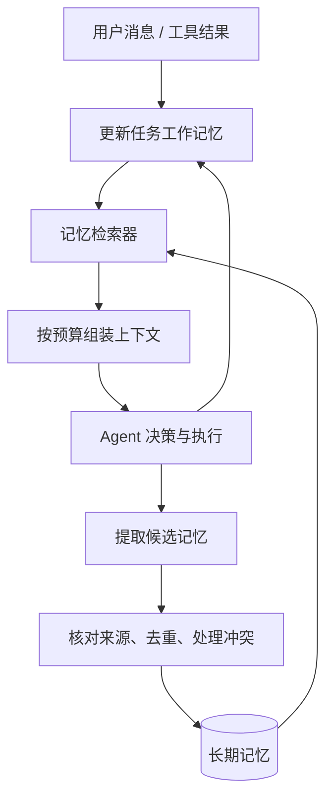

## 如何设计一个 Agent 的记忆系统。

### 设计目标
让 Agent 在需要时拿到正确、有效、适用于当前任务的信息。把它设计成：短期记忆维护“正在做什么”，长期记忆保存“以后还值得知道什么”，再用一个记忆管
理器决定写入、更新、检索和遗忘。 这就需要记忆系统要能够回答下面问题
1. 这次调用，模型需要看到什么
2. 当前任务执行到哪里了
3. 换一个任务之后，还有什么事值得保留的
上述这三个问题分别解决的是：上下文，任务状态，长期记忆。

| 层次 | 存什么 | 生命周期 | 使用方式 |
|---|---|---|---|
| 当前上下文 | 最近消息、当前步骤相关的工具结果、检索到的记忆 | 一次模型调用 | 直接放进模型输入 |
| 任务工作记忆 | 目标、约束、计划、已完成步骤、待解决问题、产物位置 | 一个任务，可跨会话 | 每轮按需加载，关键步骤保存检查点 |
| 长期记忆 | 稳定偏好、项目事实、历史经验、经过验证的方法 | 跨任务，直到更新或失效 | 按范围和相关性检索 |

### 核心架构



### 记忆划分依据
在本系统中，记忆划分的边界主要是"信息的适用范围", 其次是"未来复用价值"和"证据可靠性"来区分。

当前任务结束后，这条信息是否还应该影响其他任务的决策？

- 只对当前任务有意义 → 放在短期工作记忆。
- 对未来任务仍有明确价值 → 考虑写入长期记忆。
- 未来可能有用，但尚未证实 → 保存为候选，暂不作为有效长期记忆。
- 既不帮助当前任务，也没有明确复用价值 → 可以不进入记忆。
这里的“任务”可以跨多个会话、持续数天，因此不能按“是否跨会话”机械划分。

### 短期记忆
保存：为了完成当前任务，必须持续掌握的信息。
判断依据是：删掉它，会不会导致当前任务做错、漏做或无法恢复？

#### 如何设计

- 目标、明确约束、未完成事项单独保存，不能只依赖滚动摘要，否则多次压缩容易漏掉。
- 保存决定、依据和执行结果，不要求保存模型内部的完整推理过程。

上下文快满时，优先移出大段工具输出和过期细节，同时保留原文引用，需要时再读。


### 长期记忆
保存：在明确范围内，未来仍有复用价值，而且有足够依据的信息。
判断依据是：未来遇到什么场景时，这条信息能改善决策？

#### 如何设计
按内容类型管理

| 类型 | 示例 | 关键设计 |
|---|---|---|
| 事实与偏好 | 用户偏好中文；项目采用 PostgreSQL | 原子化记录，支持修改和有效期 |
| 情景与经验 | 上次迁移因锁表失败，拆批后通过验证 | 保存场景、行动、结果和证据 |
| 方法与流程 | 某类故障的排查顺序 | 写清适用条件，验证后才提升为可复用流程 |

还有一个独立维度是 作用范围：

```text
用户级：偏好中文解释
项目级：这个仓库使用 Poetry
任务级：这次交付必须兼容 Python 3.10
```

#### 保存与更新

##### 写入：先形成候选，再决定是否成为长期记忆

不会让 Agent 每说一句话就自动写入。

判断标准是：
未来是否有用？是否有可靠依据？适用范围是否清楚？能否表达为独立、可更新的一条记录？

具体来说：
- 用户明确要求记住的偏好：立即写入，并保留原话来源。
- 工具验证过的项目事实：写入，同时记录验证时间。
- 一次任务的执行经历：任务结束后整理为情景记忆。
- Agent 自己归纳出的经验：先作为候选；经实际验证后再提升。
- 临时情况和猜测：留在任务状态中，或设置较短有效期。

尤其要防止一种反馈循环：Agent 猜测 → 写入记忆 → 下次检索到 → 当成事实进一步强化。 同一条信息被重复检索，不能算作新的证据。


每条记忆至少带这些字段：
```text
内容、类型、作用范围、来源引用、事实/推断标记、
发生时间、有效时间、状态、替代关系
```

##### 读取：先判断适用性，再比较相似度

检索过程会是：
```text
当前目标与问题
  → 权限、用户、项目、有效期过滤
  → 精确查找 + 关键词检索 + 向量检索
  → 按适用性、证据质量、相关性排序
  → 去重、检查冲突
  → 按 token 预算放进上下文
```
不同记忆用不同读取方式：
- 用户语言偏好：按用户 ID 直接读取。
- 项目配置：按项目和配置项读取。
- 类似故障经历：关键词和语义混合检索。
- 历史决策：结合实体、时间和来源查找。
向量相似度只是召回信号。 “很像当前问题”和“能作为当前决策依据”之间，还差适用条件、时效和可信度。

同时，每条注入上下文的记忆都带来源和时间；历史记忆作为背景数据使用，不能因为被检索出来就获得指令权限。


##### 更新与遗忘：把变化作为正常情况处理

例如：
```text
过去：“默认用 Python。”
现在：“这个项目统一用 TypeScript。”
```

这两条可以同时成立：前者是一般偏好，后者是项目约束。

如果用户说“以后默认都用 TypeScript”，才需要替换原来的默认偏好。

采用：
- 明确纠正：立即更新当前有效记录，避免下一轮继续召回旧值。
- 事实变化：保留历史有效区间，例如项目曾经用 MySQL，后来迁到 PostgreSQL。
- 无法解决的冲突：标记为冲突，按需要重新验证。
- 易变化的信息：设置有效期或复核条件。
- 删除请求：同步清除正文、索引、缓存，以及从它派生出的摘要。

遗忘策略也应按类型区分：临时环境状态可以快速过期；用户明确表达的稳定偏好，不应只因很久没用就消失。


