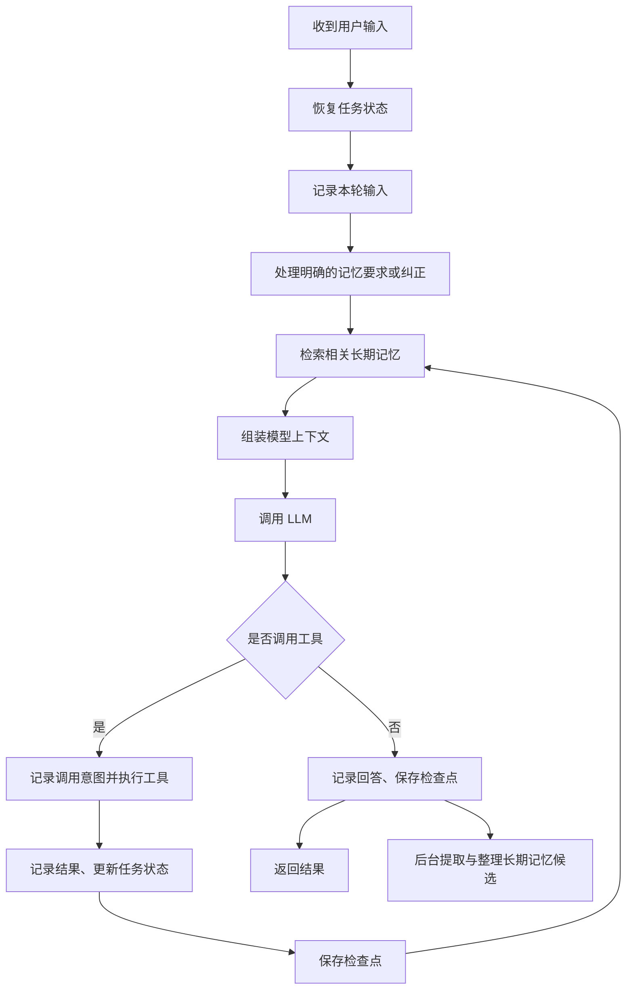

## 记忆系统的实现

记忆系统会接在 Agent 执行循环的多个位置：模型调用前负责读取和组装上下文，执行后负责记录状态，关键节点保存检查点，任务结束后整理长期记忆。

它真正起作用的方式是：把过去的信息转成这次模型调用能看到的输入，并维护执行器能够恢复的状态。 一般不需要修改模型权重。

对应的接入点：

| 时机 | 记忆系统做什么 |
|---|---|
| 一次请求开始 | 根据任务 ID 恢复状态 |
| 模型调用前 | 检索长期记忆、压缩历史、组装上下文 |
| 模型返回后 | 保存回答或工具调用记录 |
| 工具执行后 | 保存工具结果，更新进度和事实 |
| 关键步骤完成后 | 保存检查点 |
| 本轮或任务结束后 | 提取经验、去重、更新长期记忆 |
| 后台维护 | 处理过期、冲突、删除和索引更新 |

在 LangGraph 中，短期记忆对应图的 state + checkpointer，长期记忆对应跨线程的 store。